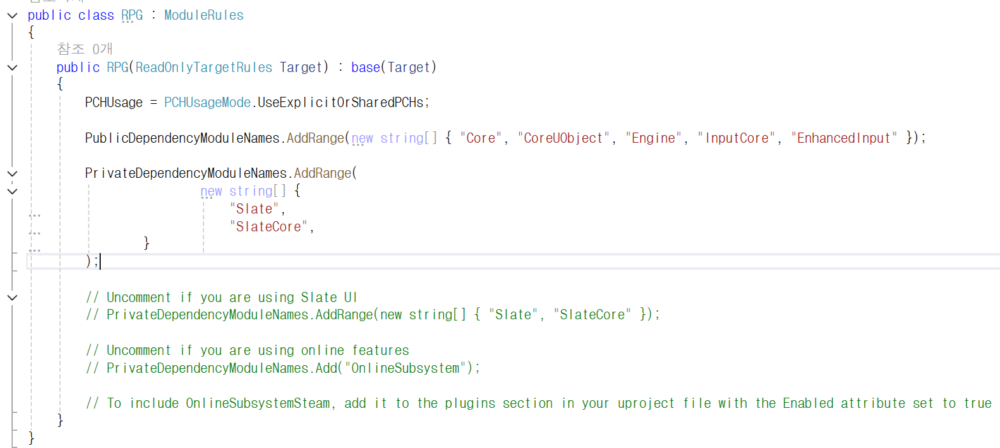
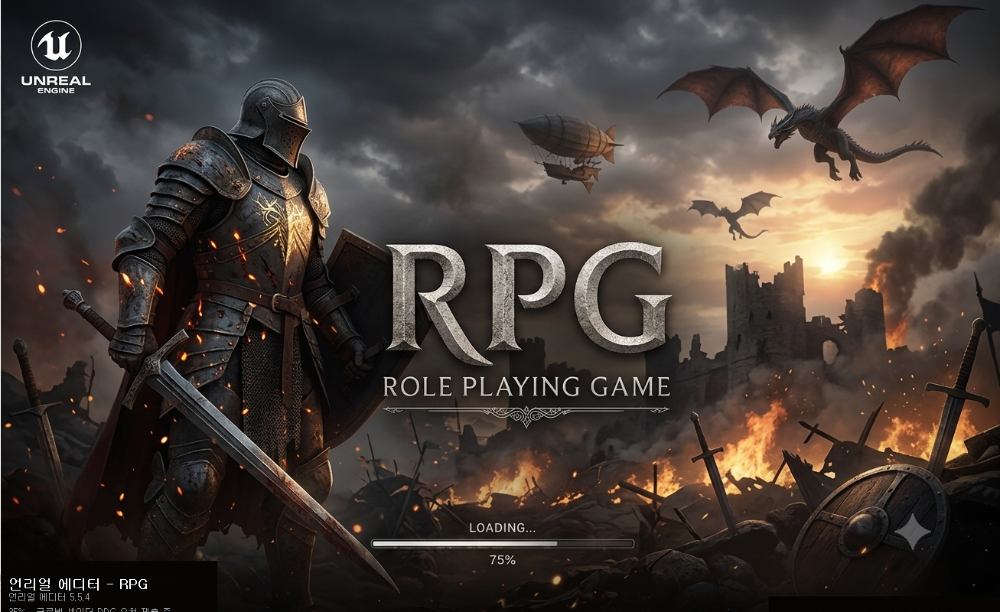
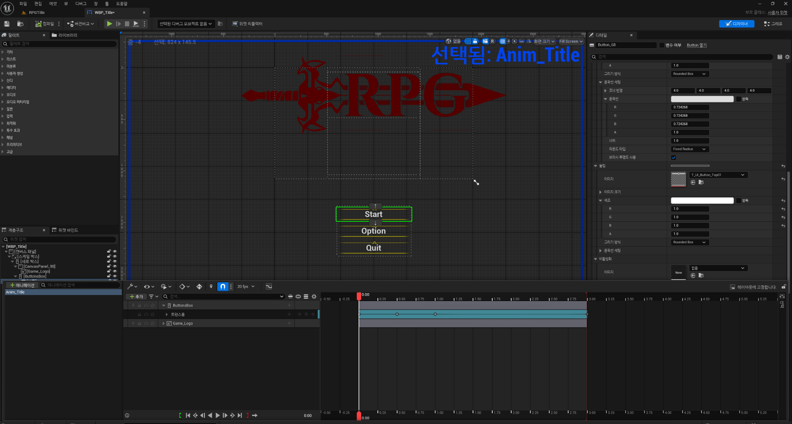
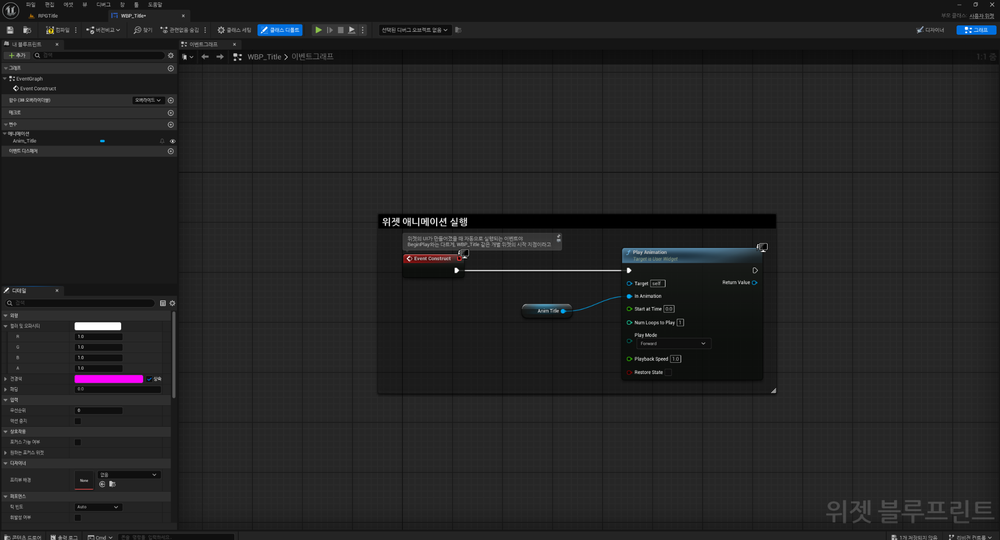
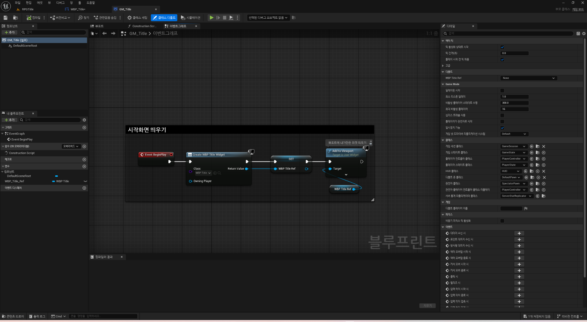
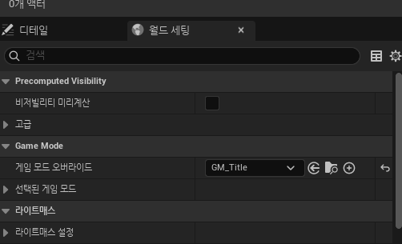

# TIL: RPG 스플래시 화면과 타이틀 UI, 게임 모드 블루프린트

## 오늘의 학습 목표

오늘은 RPG 프로젝트의 실행 화면과 타이틀 화면을 구성하고, 타이틀 위젯을 게임 모드 블루프린트에서 표시하는 흐름을 만들었다.

오늘 작업한 내용은 다음 순서로 진행했다.

1. `RPG.Build.cs`에서 Slate UI 모듈 의존성을 확인하고 추가했다.
2. 프로젝트 실행 중 표시되는 RPG 스플래시 화면을 확인했다.
3. `WBP_Title` 위젯에 RPG 로고와 메뉴 버튼을 배치했다.
4. `Anim_Title` 애니메이션을 만들고 로고에 적용했다.
5. 위젯이 만들어질 때 애니메이션을 재생하도록 연결했다.
6. `GM_Title` 게임 모드 블루프린트를 만들었다.
7. 게임 시작 시 타이틀 위젯을 생성해 뷰포트에 표시했다.
8. 월드 세팅에서 현재 레벨이 `GM_Title`을 사용하도록 지정했다.

<br>

## 1. `RPG.Build.cs`에서 Slate 모듈 설정하기

`RPG.Build.cs`는 Unreal Build Tool이 프로젝트를 빌드할 때 사용하는 모듈 설정 파일이다. 프로젝트에서 사용할 엔진 모듈과 의존성을 여기에 등록한다.

오늘 확인한 `RPG.Build.cs`에는 기본 모듈과 Enhanced Input 모듈이 Public 의존성으로 들어 있고, Slate UI 관련 모듈은 Private 의존성으로 추가되어 있다.

```csharp
PublicDependencyModuleNames.AddRange(
    new string[]
    {
        "Core",
        "CoreUObject",
        "Engine",
        "InputCore",
        "EnhancedInput"
    }
);

PrivateDependencyModuleNames.AddRange(
    new string[]
    {
        "Slate",
        "SlateCore"
    }
);
```

`PublicDependencyModuleNames`에는 다른 모듈에서도 필요한 의존성을 등록하고, `PrivateDependencyModuleNames`에는 현재 모듈 내부에서 사용할 의존성을 등록한다.

이번에 추가한 `Slate`와 `SlateCore`는 Unreal의 UI 기능과 관련된 모듈이다. 이 모듈을 `Build.cs`에 등록하면 C++ 모듈에서 Slate 관련 기능을 사용할 수 있다.

이 설정 자체가 스플래시 이미지를 만들어 주는 것은 아니다. **모듈 의존성 설정과 스플래시 화면 구성은 서로 다른 작업**이다.



<br>

## 2. RPG 스플래시 화면 확인하기

스플래시 화면은 게임이 시작되거나 로딩되는 동안 잠시 표시되는 시작 화면이다. 이번 작업에서는 RPG 프로젝트에 어울리는 이미지를 사용해 프로젝트 실행 중 표시되는 스플래시 화면을 확인했다.

스플래시 화면에는 RPG 로고와 게임 분위기에 맞는 배경 이미지가 보인다. 로딩 중인 상태를 보여 주는 문구와 진행 표시도 함께 표시된다.



### 스플래시 화면과 타이틀 화면의 차이

스플래시 화면과 타이틀 화면은 용도가 다르다.

| 구분 | 스플래시 화면 | 타이틀 화면 |
|---|---|---|
| 표시되는 시점 | 프로젝트가 시작되거나 로딩되는 동안 | 게임이 시작된 뒤 |
| 목적 | 로딩 중 프로젝트의 이름과 분위기를 보여 줌 | Start, Option, Quit 같은 메뉴를 제공 |
| 이번 작업에서 확인한 내용 | RPG 로고와 로딩 화면 | `WBP_Title` 위젯과 메뉴 버튼 |

스플래시 화면이 끝난 뒤 게임 안에서 보여 줄 메뉴는 `WBP_Title` 위젯으로 따로 만들었다.

<br>

## 3. `WBP_Title` 위젯 구성하기

타이틀 화면은 `WBP_Title` 위젯에서 구성했다. 위젯 디자이너에서 RPG 로고를 배치하고 Start, Option, Quit 버튼을 화면에 정리했다.

위젯 디자이너에서는 화면에 표시될 요소를 배치하고, 각 요소의 크기와 위치, 색상, 이미지 같은 속성을 조정할 수 있다.



<br>

## 4. `Anim_Title` 애니메이션 만들기

`WBP_Title` 위젯에서 `Anim_Title`이라는 애니메이션을 만들었다. 애니메이션 타임라인에 로고의 변화를 기록할 키를 추가하고, 시간이 지남에 따라 로고가 움직이도록 구성했다.

애니메이션 타임라인에서는 다음과 같은 작업을 할 수 있다.

1. 애니메이션을 적용할 위젯을 선택한다.
2. 타임라인에서 애니메이션을 적용할 시간을 정한다.
3. 해당 시점의 위젯 속성을 기록한다.
4. 다른 시간에도 키를 추가해 시작 상태와 끝 상태를 만든다.
5. 두 키 사이의 값이 시간에 따라 변하도록 애니메이션을 재생한다.

이번 작업에서는 `Game_Logo`의 트랜스폼을 애니메이션 트랙에 추가하고, 타임라인에 키를 배치해 로고 애니메이션을 만들었다.

<br>

## 5. `Event Construct`에서 애니메이션 재생하기

애니메이션을 만들기만 하면 위젯이 표시될 때 자동으로 재생되는 것은 아니다. 위젯의 이벤트 그래프에서 `Event Construct`와 `Play Animation`을 연결했다.

구성한 흐름은 다음과 같다.

```text
Event Construct
    → Play Animation
        → Anim_Title
```

`Event Construct`는 위젯이 화면에 표시될 준비가 될 때 실행되는 이벤트다. 이 이벤트에서 `Play Animation`을 호출하면 위젯이 만들어질 때 `Anim_Title`이 시작된다.

`Play Animation` 노드의 `In Animation`에는 `Anim_Title`을 연결했다. 스크린샷에서는 재생 횟수가 1로 설정되어 있다.



<br>

## 6. 게임 모드 블루프린트란?

게임 모드 블루프린트는 현재 게임에서 사용할 기본 규칙과 주요 클래스를 설정하는 블루프린트다.

게임 모드에서는 프로젝트의 목적에 따라 다음과 같은 클래스를 지정할 수 있다.

- 게임에서 사용할 플레이어 컨트롤러
- 플레이어가 조종할 폰 또는 캐릭터
- 플레이어 상태를 관리할 클래스
- 게임 상태를 관리할 클래스
- HUD 클래스
- 기본 플레이어 폰 클래스

게임 모드는 게임 시작 시 실행할 흐름을 블루프린트로 구성하는 데에도 사용할 수 있다. 이번 작업에서는 `GM_Title`의 `BeginPlay`에서 타이틀 위젯을 만들어 화면에 표시하도록 했다.

### 게임 모드와 게임 상태의 차이

게임 모드는 게임의 규칙과 플레이 방식을 정하는 역할을 한다. 게임 상태는 현재 게임 상태처럼 여러 플레이어가 함께 알아야 하는 정보를 관리할 때 사용한다.

멀티플레이 게임에서는 게임 모드가 서버에 존재한다. 여러 클라이언트가 함께 알아야 하는 상태를 복제해야 할 때는 게임 상태 같은 클래스를 사용할 수 있다. 이번 작업에서는 타이틀 화면을 띄우는 흐름을 게임 모드에서 구성했다.

<br>

## 7. `GM_Title`에서 타이틀 위젯 생성하기

게임 모드 블루프린트 `GM_Title`의 이벤트 그래프에서 `Event BeginPlay`를 사용했다.

`BeginPlay`는 게임 플레이가 시작될 때 실행되는 이벤트다. 이 이벤트에서 아래 노드들을 순서대로 연결했다.

```text
Event BeginPlay
    → Create Widget (WBP_Title)
    → Set WBP_Title_Ref
    → Add to Viewport
```

### 각 노드의 역할

#### `Create Widget`

`WBP_Title` 위젯의 인스턴스를 만든다. 위젯 클래스에 `WBP_Title`을 지정하면 해당 위젯을 사용할 준비가 된다.

#### `Set WBP_Title_Ref`

`Create Widget`에서 반환된 위젯 참조를 `WBP_Title_Ref` 변수에 저장한다. 이후 같은 위젯을 다시 사용하거나 화면에서 제거할 때 변수에 저장해 둔 참조를 사용할 수 있다.

#### `Add to Viewport`

만들어진 위젯 인스턴스를 게임 화면에 표시한다. `Create Widget`만 실행하면 위젯 인스턴스는 만들어지지만, 화면에 보이도록 추가하는 작업은 별도로 필요하다.



<br>

## 8. 월드 세팅에서 `GM_Title` 지정하기

게임 모드 블루프린트를 만들었어도 레벨이 그 게임 모드를 사용하도록 지정해야 한다.

월드 세팅의 Game Mode 항목에서 `Game Mode Override`를 `GM_Title`로 설정했다. 이 값은 해당 레벨에서 사용할 게임 모드를 지정한다.

프로젝트 기본 게임 모드와 현재 레벨의 게임 모드가 다를 수 있으므로, 특정 레벨에서 다른 게임 모드를 사용하려면 해당 레벨의 월드 세팅을 확인해야 한다.



<br>

## 9. 전체 실행 흐름 정리

이번 작업에서 구성한 전체 흐름은 다음과 같다.

```text
프로젝트 실행
    → RPG 스플래시 화면 표시
    → 레벨 시작
    → GM_Title의 Event BeginPlay 실행
    → WBP_Title 위젯 생성
    → 위젯 참조를 WBP_Title_Ref에 저장
    → 위젯을 뷰포트에 추가
    → WBP_Title의 Event Construct 실행
    → Anim_Title 애니메이션 재생
```

여기서 중요한 점은 스플래시 화면과 타이틀 UI가 서로 다른 과정이라는 것이다. 스플래시 화면은 프로젝트가 로딩되는 동안 표시되고, 타이틀 UI는 레벨이 시작된 뒤 게임 모드에서 위젯을 생성해 화면에 추가하면서 표시된다.

<br>

## 10. 실습 영상

[스플래시 화면과 타이틀 UI 실습 영상 보기](assets/2026-11-24/07_RPG_Splash_Title_UI_Workflow.mp4)

<br>

## 헷갈렸던 점과 해결 과정

### 스플래시 화면과 타이틀 화면을 구분하기

처음에는 RPG 로고가 나오는 화면을 모두 타이틀 화면이라고 생각할 수 있다. 하지만 로딩 중 보여 주는 스플래시 화면과 게임 안에서 메뉴 버튼을 제공하는 타이틀 UI는 다른 화면이다.

이번 프로젝트에서는 로딩 중 표시되는 RPG 스플래시 화면과 `WBP_Title`로 만든 메뉴 화면을 각각 확인했다.

### 위젯을 만들었는데 화면에 보이지 않는 경우

`Create Widget`은 위젯 인스턴스를 만드는 노드다. 위젯을 실제 화면에 표시하려면 `Add to Viewport`도 실행해야 한다.

따라서 아래 두 단계가 모두 필요하다.

```text
Create Widget
    → Add to Viewport
```

### 만든 게임 모드가 레벨에서 적용되지 않는 경우

게임 모드 블루프린트를 만드는 것만으로는 현재 레벨이 그 게임 모드를 사용한다고 정해지지 않는다. 월드 세팅의 `Game Mode Override`에서 사용할 게임 모드를 지정해야 한다.

이번 레벨에서는 `Game Mode Override`를 `GM_Title`로 설정했다.

### 애니메이션이 자동으로 재생되지 않는 경우

애니메이션을 위젯에 만들기만 하면 자동 실행되는 것은 아니다. 위젯의 이벤트 그래프에서 `Play Animation`을 호출해야 한다.

이번에는 위젯이 생성될 때 실행되는 `Event Construct`에서 `Anim_Title`을 재생하도록 연결했다.

<br>

## 오늘 배운 내용 요약

프로젝트 실행 중 보여 줄 스플래시 화면과 게임 내 타이틀 메뉴를 각각 확인하고 구성했다. `WBP_Title`에 `Anim_Title`을 만들고 `Event Construct`에서 재생하도록 연결했다. `GM_Title`의 `BeginPlay`에서는 타이틀 위젯을 생성해 뷰포트에 추가했고, 월드 세팅의 `Game Mode Override`를 `GM_Title`로 지정해 현재 레벨에 적용했다.
