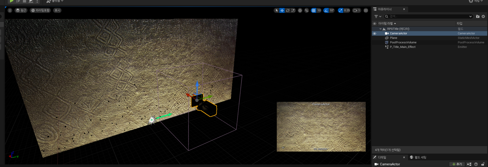
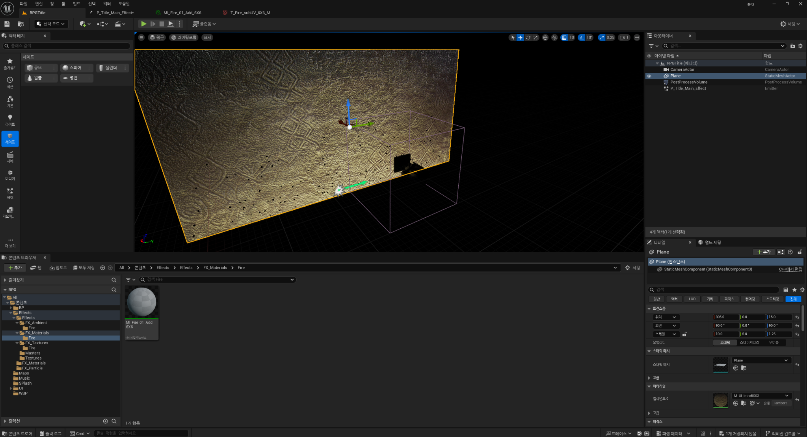
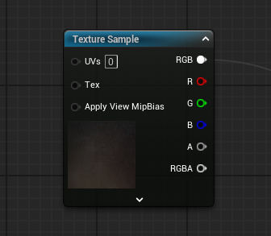
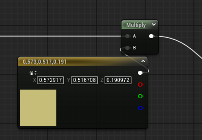
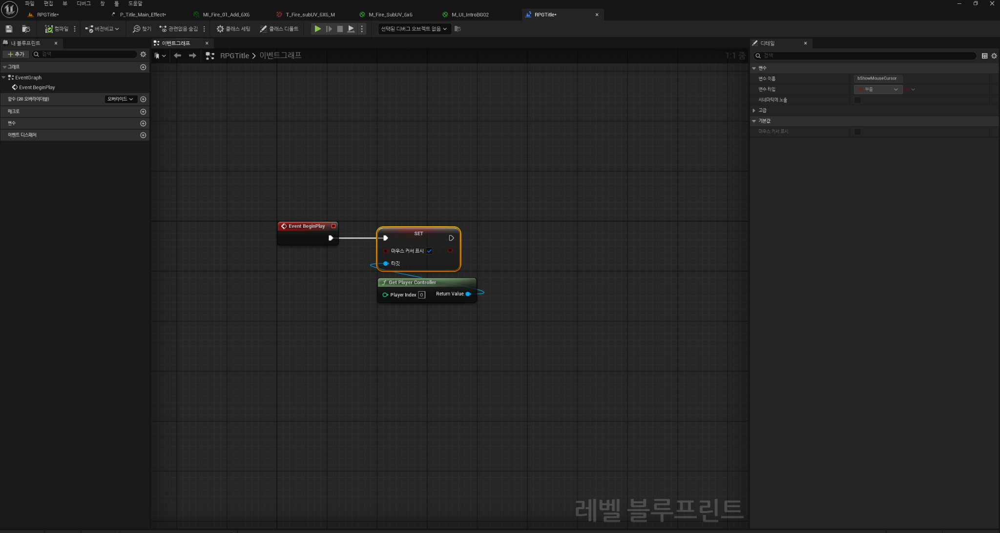
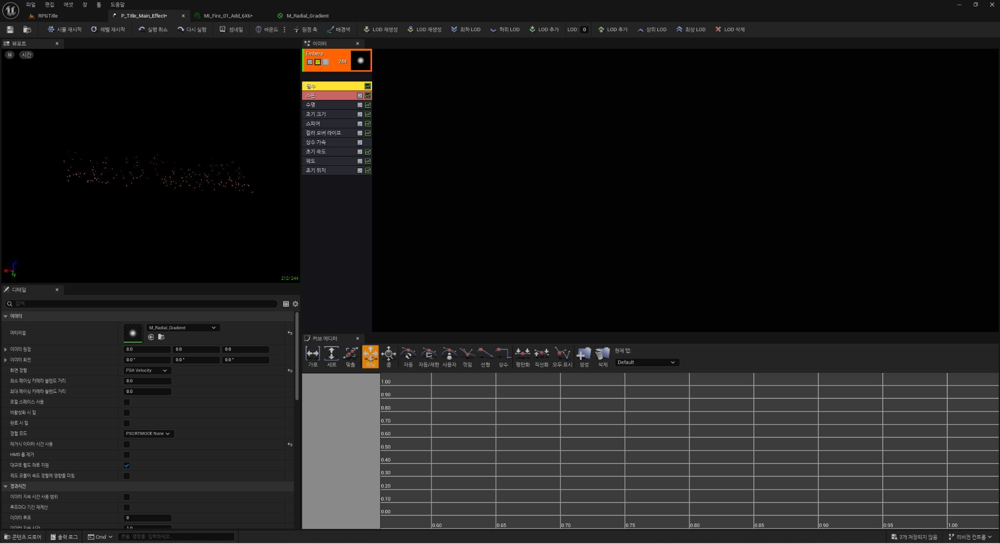
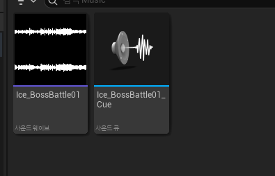
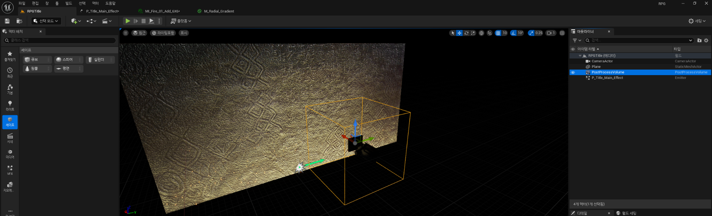

# TIL: 언리얼 엔진 타이틀 화면 구성하기

<br>

## 오늘 배운 내용

오늘은 언리얼 엔진에서 타이틀 화면을 구성하는 데 필요한 카메라, 배경 평면, 머티리얼, 마우스 커서, 파티클, 사운드, 포스트 프로세스 볼륨을 살펴봤다.

타이틀 화면은 카메라가 바라보는 장면을 정하고, 배경과 효과를 배치한 뒤, 플레이어가 버튼을 선택할 수 있도록 마우스 커서를 표시하는 방식으로 구성할 수 있다.

---

<br>

## 1. CameraActor 배치하기

첫 번째 이미지처럼 레벨에 `CameraActor`를 배치하면 게임 화면을 보여줄 위치와 방향을 정할 수 있다. 카메라의 위치와 회전을 조절해 배경 평면과 이펙트가 원하는 구도로 보이도록 맞춘다.

카메라를 레벨에 배치하는 것만으로 게임이 자동으로 그 카메라를 사용하지는 않는다. 게임 시작 시 플레이어 컨트롤러의 시점을 해당 카메라로 바꾸려면 `Set View Target with Blend`를 사용할 수 있다.

```text
Event BeginPlay
→ Get Player Controller
→ Set View Target with Blend
→ New View Target에 CameraActor 연결
```



---

<br>

## 2. 시작 화면 배경으로 사용할 Plane

두 번째 이미지에서는 큰 `Plane`에 배경 머티리얼을 적용했다. 이 평면은 게임이 시작될 때 카메라에 보이는 배경 화면으로 사용할 수 있다.

평면의 크기와 위치를 조절해 카메라 화면을 충분히 덮도록 배치한다. 화면에 보이지 않는다면 평면이 카메라 앞에 있는지, 평면의 앞면이 카메라를 향하는지 확인한다.



---

<br>

## 3. Texture Sample 노드

`Texture Sample`은 텍스처의 색상 정보를 머티리얼 그래프로 가져오는 노드다. 출력에는 색상 채널인 `R`, `G`, `B`와 알파 채널인 `A`가 있다.

텍스처를 평면에 표시하려면 보통 `RGB` 출력을 머티리얼의 `Base Color`에 연결한다.

```text
Texture Sample RGB
→ Base Color
```



---

<br>

## 4. Multiply 노드로 색상 조절하기

`Multiply` 노드는 두 입력값을 곱한다. 텍스처 색상과 색상값을 곱하면 텍스처의 색조를 바꿀 수 있고, 밝기 조절에도 활용할 수 있다.

```text
Texture Color ──→ Multiply ──→ Base Color
Color Value ────→ Multiply
```

이미지의 노란색 계열 값처럼 색상을 입력하면 텍스처에 그 색조가 더해진다. 값이 너무 낮거나 높으면 결과가 어두워지거나 색이 과하게 강조될 수 있으므로 화면을 확인하면서 조절한다.




---

<br>

## 5. Level Blueprint에서 마우스 커서 표시하기

타이틀 화면에서는 마우스로 버튼을 선택하는 경우가 많다. 다섯 번째 이미지처럼 `Event BeginPlay`에서 플레이어 컨트롤러를 가져와 `Show Mouse Cursor`를 켜면 게임이 시작될 때 커서를 표시할 수 있다.

```text
Event BeginPlay
→ Get Player Controller
→ Set Show Mouse Cursor
→ Show Mouse Cursor 체크
```



---

<br>

## 6. Niagara 이미터로 불씨 효과 만들기

여섯 번째 이미지에는 `Embers` 이미터가 보인다. Niagara 이미터는 입자를 생성하고, 입자의 크기·색상·속도·수명 등을 조절해 불씨 같은 시각 효과를 만든다.

이미터에 적용된 `M_Radial_Gradient` 같은 머티리얼은 입자 중심을 밝게 하고 가장자리를 부드럽게 표현하는 데 사용할 수 있다.

파티클이 보이지 않는다면 이미터가 재생 중인지, 카메라 시야 안에 배치되어 있는지, 머티리얼과 입자 크기가 적절한지 확인한다.



---

<br>

## 7. Sound Wave와 Sound Cue

일곱 번째 이미지에는 `Sound Wave`와 `Sound Cue` 에셋이 보인다.

- `Sound Wave`: 가져온 오디오 파일을 나타내는 에셋
- `Sound Cue`: 사운드 재생 방식과 연결을 구성하는 에셋

단순한 사운드를 재생할 때는 `Sound Wave`를 사용할 수 있다. 여러 사운드를 연결하거나 볼륨과 피치 등을 조절하고 싶다면 `Sound Cue`를 활용할 수 있다.



---

<br>

## 8. PostProcessVolume으로 화면 분위기 조절하기

마지막 이미지에는 `PostProcessVolume`이 배치되어 있다. 포스트 프로세스 볼륨은 카메라가 렌더링한 화면에 후처리 효과를 적용한다. 색상 보정, 노출, 대비, 블룸 등을 조절해 화면의 분위기를 바꿀 수 있다.

볼륨이 특정 영역에만 적용되게 하려면 크기와 위치를 조절한다. 레벨 전체에 적용하려면 `Infinite Extent (Unbound)` 옵션을 켠다.



---

<br>

## 헷갈린 점과 확인 과정

- `CameraActor`를 배치해도 게임 시작 시 시점이 자동으로 바뀌는 것은 아니다. 필요하면 플레이어 컨트롤러의 뷰 타깃을 설정한다.
- `Texture Sample`은 텍스처를 불러오는 노드다. 텍스처가 보이려면 머티리얼 출력에 연결해야 한다.
- `Multiply`는 색상값을 곱하므로 입력값에 따라 색감과 밝기가 달라진다.
- 마우스 커서는 플레이어 컨트롤러에서 표시 설정을 켜야 한다.
- `PostProcessVolume`을 레벨 전체에 적용하려면 `Infinite Extent (Unbound)` 설정을 확인한다.

---

<br>

## 오늘 배운 내용 정리

타이틀 화면은 `CameraActor`로 시점을 정하고, 머티리얼이 적용된 `Plane`으로 배경을 만들 수 있다. `Texture Sample`으로 텍스처를 불러오고 `Multiply`로 색감을 조절한다. 레벨 블루프린트에서 마우스 커서를 표시하고, Niagara 파티클과 사운드로 화면에 효과를 더할 수 있다. `PostProcessVolume`은 화면 전체의 색감과 후처리 분위기를 조절하는 데 사용한다.
