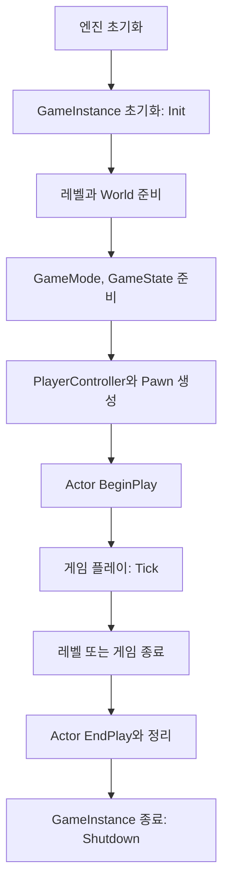
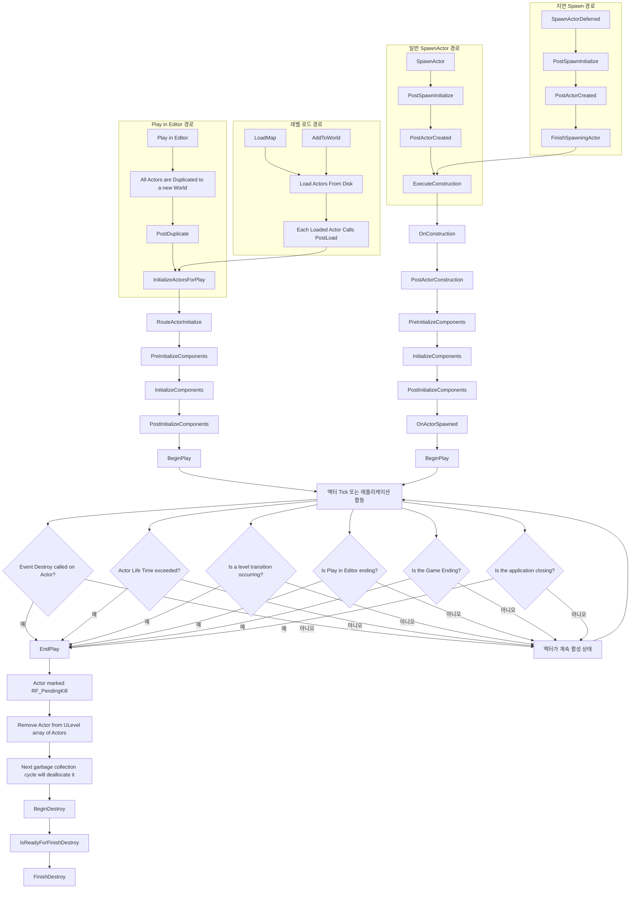
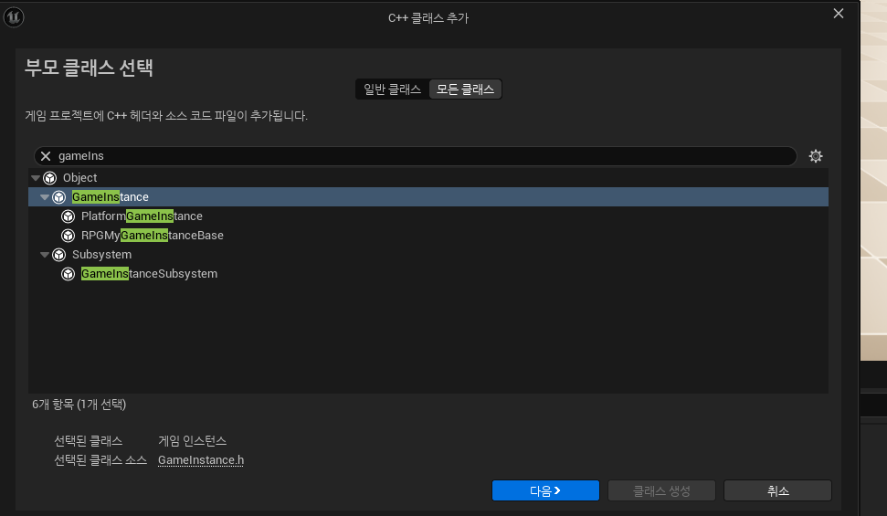
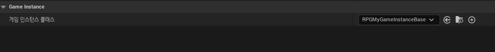
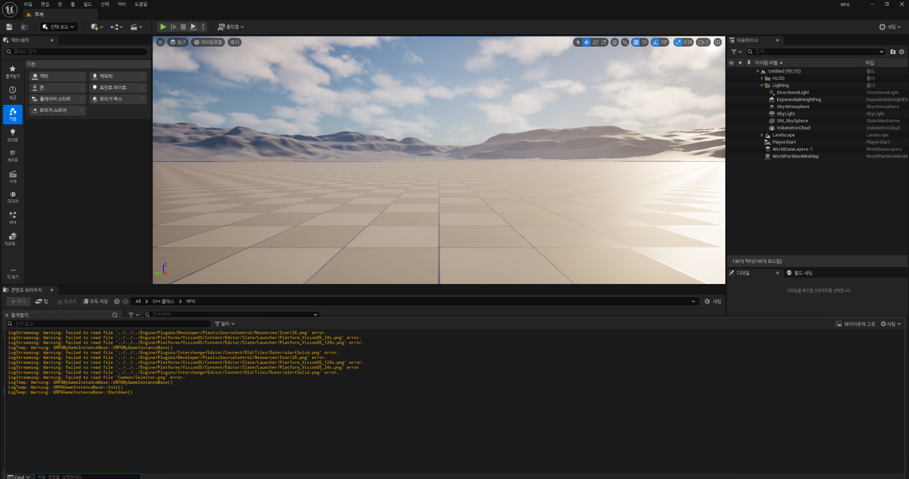

# TIL: Unreal Engine 생명주기와 `UGameInstance`

<br>

## 오늘 배운 내용

언리얼 엔진의 생명주기를 살펴보고, 게임 전체에서 유지되는 `UGameInstance` 클래스를 C++로 만들어 초기화와 종료 로그를 확인했다.

---
<br>

## 1. 언리얼 엔진의 전체 생명주기

생명주기(Lifecycle)는 객체나 프로그램이 만들어진 뒤 초기화되고, 사용되다가 종료되는 순서를 말한다.

언리얼 프로젝트를 실행하면 엔진과 게임 인스턴스가 준비되고, 레벨이 로드된 뒤 게임 월드와 액터들이 초기화된다. 게임이 시작되면 액터의 `BeginPlay()`가 호출되고, 플레이 중에는 필요한 액터의 `Tick()`이 반복해서 실행된다. 게임이나 레벨이 종료될 때는 관련 객체의 종료 처리가 이어진다.



이 흐름은 게임 실행의 큰 그림을 이해하기 위한 요약이다. 실제 호출 순서는 실행 방식, 레벨 전환 방식, 액터 종류에 따라 달라질 수 있다.

<br>

# Unreal Actor LifeCycle Flowchart



<br>

### 액터의 일반적인 생명주기

| 단계 | 역할 |
|---|---|
| 생성자(Constructor) | 객체가 생성될 때 기본값과 컴포넌트를 설정한다. |
| `OnConstruction()` | 액터가 배치되거나 생성될 때 구성과 외형을 갱신한다. |
| 컴포넌트 초기화 | 액터에 속한 컴포넌트가 초기화된다. |
| `BeginPlay()` | 게임 플레이가 시작될 때 한 번 호출된다. |
| `Tick()` | 매 프레임 호출될 수 있다. 필요하지 않은 액터는 Tick을 비활성화할 수 있다. |
| `EndPlay()` | 액터가 레벨에서 제거되거나 플레이가 끝날 때 정리 작업을 한다. |
| 소멸 | 더 이상 사용되지 않는 객체가 정리된다. `UObject`는 가비지 컬렉션 대상이 될 수 있다. |

`Destroy()`는 액터를 월드에서 제거하도록 요청하는 함수다. 호출 직후 C++ 객체 메모리가 즉시 해제된다는 뜻은 아니다. 실제 정리와 메모리 회수는 언리얼의 객체 생명주기와 가비지 컬렉션에 따라 처리된다.

---

<br>

## 2. 레벨을 이동할 때 객체의 유지 범위

`OpenLevel`처럼 일반적인 레벨 전환을 하면 새 월드가 만들어진다. 이때 월드에 속한 액터들은 보통 새로 만들어지지만, `GameInstance`는 게임 세션 동안 유지된다.

| 객체 | 일반적인 레벨 전환에서의 역할 |
|---|---|
| `GameInstance` | 게임 세션 전체에서 유지되는 전역 상태를 관리한다. |
| `GameMode` | 현재 월드의 게임 규칙을 관리한다. |
| `GameState` | 현재 월드의 게임 상태를 관리한다. |
| `PlayerController` | 현재 월드에서 플레이어 입력과 제어를 담당한다. |
| `Character` / `Pawn` | 현재 월드에서 플레이어가 조작하는 캐릭터를 나타낸다. |
| `Actor` | 현재 월드에 배치되거나 생성된 게임 객체다. |

`Seamless Travel`을 사용하면 일부 액터를 레벨 사이에 유지하도록 설정할 수 있다. 따라서 위 표는 일반적인 레벨 전환을 이해하기 위한 기준으로 본다.

---

<br>

## 3. `UObject`와 언리얼 C++

일반적인 네이티브 C++에서는 메모리를 직접 관리해야 하는 상황이 생길 수 있다. 할당한 메모리를 해제하지 않으면 메모리 누수가 발생할 수 있고, 잘못된 해제는 크래시의 원인이 될 수 있다.

언리얼의 `UObject` 계열은 리플렉션, 가비지 컬렉션, 에디터 및 블루프린트 연동 같은 엔진 기능을 제공한다. 엔진이 객체를 추적하고 정리할 수 있도록 `UCLASS()`, `GENERATED_BODY()` 같은 매크로와 언리얼의 참조 관리 규칙을 사용한다.

새 C++ 클래스를 만들 때 부모 클래스로 `UObject` 또는 `UGameInstance` 등을 선택하면 언리얼의 객체 시스템에 참여하는 클래스를 만들 수 있다.

> 주의: 모든 C++ 포인터가 자동으로 가비지 컬렉션에 의해 관리되는 것은 아니다. 언리얼 객체 참조를 보관할 때는 `UPROPERTY()` 등 엔진이 추적할 수 있는 방식인지 확인해야 한다.

---

<br>

## 4. `GameInstance` 클래스 만들기

언리얼 에디터의 C++ 클래스 추가 창에서 `GameInstance`를 부모 클래스로 선택해 사용자 정의 게임 인스턴스 클래스를 만들 수 있다.



클래스를 만든 뒤에는 프로젝트 설정의 `Game Instance Class` 항목에 생성한 클래스를 지정해야 한다. 지정해야 게임 실행 중 해당 사용자 정의 클래스가 사용된다.



---

<br>

## 5. `UGameInstance`의 `Init()`과 `Shutdown()`

`UGameInstance`는 게임 실행 전체를 관리하는 상위 객체다. 일반적인 레벨 전환에도 유지되므로, 레벨이 바뀌어도 계속 보관해야 하는 게임 세션 데이터나 공통 초기화 작업을 관리할 수 있다.

- `Init()`은 게임 인스턴스가 초기화될 때 호출된다.
- `Shutdown()`은 게임 인스턴스가 종료될 때 정리 작업을 넣을 수 있는 함수다.
- 두 함수 모두 부모 클래스의 구현을 유지하기 위해 `Super::` 호출을 포함한다.

### 헤더 파일

```cpp
// Fill out your copyright notice in the Description page of Project Settings.

#pragma once

#include "CoreMinimal.h"
#include "Engine/GameInstance.h"
#include "RPGMyGameInstanceBase.generated.h"

UCLASS()
class RPG_API URPGMyGameInstanceBase : public UGameInstance
{
    GENERATED_BODY()

public:
    URPGMyGameInstanceBase();

    virtual void Init() override;
    virtual void Shutdown() override;
};
```

### 소스 파일

```cpp
// Fill out your copyright notice in the Description page of Project Settings.

#include "RPGMyGameInstanceBase.h"

URPGMyGameInstanceBase::URPGMyGameInstanceBase()
{
    UE_LOG(LogTemp, Warning,
        TEXT("URPGMyGameInstanceBase::URPGMyGameInstanceBase()"));
}

void URPGMyGameInstanceBase::Init()
{
    Super::Init();

    // 게임 인스턴스 초기화 코드
    UE_LOG(LogTemp, Warning,
        TEXT("URPGGameInstanceBase::Init()"));
}

void URPGMyGameInstanceBase::Shutdown()
{
    // 종료 전 정리 코드

    Super::Shutdown();

    UE_LOG(LogTemp, Warning,
        TEXT("URPGGameInstanceBase::Shutdown()"));
}
```

### 코드에서 확인할 점

- 생성자는 객체가 만들어질 때 기본 상태를 설정한다.
- `Init()`은 게임 인스턴스 초기화 지점이다.
- `Shutdown()`은 게임 인스턴스 종료 전 정리 지점이다.
- `UE_LOG`의 `TEXT(...)`는 로그에 출력할 문자열이다.
- 로그 문자열은 임의로 작성할 수 있지만, 실제 클래스 이름과 맞추면 로그를 읽을 때 혼동이 줄어든다.
- 클래스 이름은 `URPGMyGameInstanceBase`인데 로그 문자열에는 `URPGGameInstanceBase`라고 적혀 있다. 이 문자열 차이만으로 함수 호출 여부가 달라지지는 않는다.

---

<br>

## 6. 실행 로그 확인

프로젝트 설정에서 `RPGMyGameInstanceBase`를 지정하고 게임을 실행한 뒤 종료하면, 생성자와 `Init()`, `Shutdown()` 로그를 확인할 수 있다.



로그에 다음 메시지가 출력되는 것을 확인했다.

```text
URPGGameInstanceBase::URPGGameInstanceBase()
URPGGameInstanceBase::Init()
URPGGameInstanceBase::Shutdown()
```

로그 문자열이 화면에 출력됐다는 것은 해당 로그 코드가 실행됐다는 뜻이다. 에디터 로그에 함께 나타나는 `Failed to read file` 경고는 위의 `GameInstance` 로그와는 별개의 파일 경고다.

---

<br>

## 헷갈린 점과 해결 과정

### `GameInstance`는 레벨마다 새로 만들어질까?

일반적인 레벨 전환에서는 `GameInstance`가 유지된다. 레벨에 속한 `World`와 액터는 새로 구성되지만, `GameInstance`는 게임 세션 전체를 관리하기 때문이다.

### 생성자와 `Init()`은 어떤 차이가 있을까?

생성자는 객체의 기본 상태를 구성한다. `Init()`은 게임 인스턴스의 초기화 단계에서 실행되므로, 게임 인스턴스의 실제 초기화 작업을 작성하는 위치로 사용한다.

### `Shutdown()`과 C++ 소멸자는 같은 함수일까?

같지 않다. `Shutdown()`은 언리얼의 게임 인스턴스 종료 단계에서 호출되는 가상 함수다. C++ 소멸자는 객체의 메모리 수명이 끝날 때 호출되는 함수다. 게임 종료 시점의 엔진 정리 작업은 `Shutdown()`에 두고, 소멸자는 객체 자체의 수명 종료와 관련된 용도로 생각한다.

---

<br>

## 오늘 배운 내용 정리

- `GameInstance`는 일반적인 레벨 전환 뒤에도 유지되는 게임 세션 단위 객체다.
- `Init()`에는 게임 인스턴스 초기화 작업을 작성한다.
- `Shutdown()`에는 게임 인스턴스 종료 전 정리 작업을 작성한다.
- 부모 클래스의 동작을 유지하려면 `Super::Init()`과 `Super::Shutdown()`을 호출한다.
- 사용자 정의 `GameInstance` 클래스를 만든 뒤 프로젝트 설정의 `Game Instance Class`에 지정해야 한다.
- `UObject` 계열은 언리얼의 리플렉션과 가비지 컬렉션 같은 객체 시스템을 사용할 수 있게 한다.

<br>

## 참고 자료

- Epic Games, [UGameInstance API — Unreal Engine 5.5](https://dev.epicgames.com/documentation/unreal-engine/API/Runtime/Engine/Engine/UGameInstance?application_version=5.5)
- Epic Games, [Game Flow Overview — Unreal Engine 4.27](https://dev.epicgames.com/documentation/en-us/unreal-engine/game-flow-overview?application_version=4.27)
- Epic Games, [Programming Subsystems in Unreal Engine](https://dev.epicgames.com/documentation/en-us/unreal-engine/programming-subsystems-in-unreal-engine)
