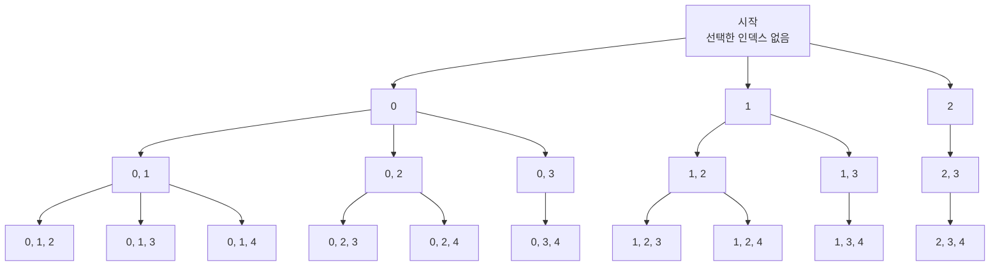

# TIL: 조합과 재귀를 이용한 조합 만들기

<br><br>

## 오늘 배운 내용

조합은 주어진 원소 중에서 몇 개를 뽑는 방법이다. **뽑는 순서는 고려하지 않는다.**

예를 들어 `{1, 2, 3}` 중 2개를 뽑으면 `{1, 2}`와 `{2, 1}`은 같은 조합이다. 두 원소의 순서만 다를 뿐, 선택한 원소가 같기 때문이다.

반면 순열은 원소를 뽑는 순서도 구별한다. 그래서 `{1, 2}`와 `{2, 1}`을 서로 다른 경우로 센다.

<br>

## 조합의 공식

`n`개 중에서 `k`개를 고르는 조합의 수는 다음과 같다.

```text
nCk = n! / (k! × (n - k)!)
```

예를 들어 5개 중 3개를 고르는 경우는 다음과 같다.

```text
5C3 = 5! / (3! × 2!) = 10
```

따라서 `{1, 2, 3, 4, 5}`에서 3개를 뽑는 조합은 총 10개다.

<br>

## 조합을 재귀로 만드는 과정

아래 그림은 0부터 4까지의 인덱스 중에서 3개를 고르는 과정을 나타낸다. 코드에서는 `start`보다 큰 인덱스만 다음에 선택하므로, 같은 인덱스를 다시 고르거나 순서만 다른 조합을 만들지 않는다.



그래프는 한 갈래를 따라가며 인덱스를 하나씩 선택한다. 세 개를 선택하면 조합을 출력하고, 재귀 함수에서 돌아온 뒤 마지막에 추가한 인덱스를 제거하고 다음 인덱스를 시도한다.

위 그림은 조합을 완성해 출력하는 경로를 중심으로 나타냈다. 예를 들어 `[0, 4]`처럼 세 개를 채울 수 없는 경로도 실제 코드에서 잠시 확인한 뒤, 더 선택할 인덱스가 없어 돌아온다. 그런 종료 경로는 그림에서 생략했다.

<br>

## 재귀를 이용한 조합 코드

```cpp
#include <bits/stdc++.h>
using namespace std;

int n = 5;
int k = 3;

void print(const vector<int>& selected)
{
    for (int index : selected)
    {
        cout << index << " ";
    }

    cout << "\n";
}

void combi(int start, vector<int>& selected)
{
    // k개를 모두 선택하면 조합을 출력하고 돌아간다.
    if (selected.size() == k)
    {
        print(selected);
        return;
    }

    // start보다 큰 인덱스만 선택한다.
    for (int i = start + 1; i < n; i++)
    {
        selected.push_back(i);

        // 다음 인덱스를 선택하도록 재귀 호출한다.
        combi(i, selected);

        // 재귀 호출에서 돌아오면 마지막 선택을 취소한다.
        selected.pop_back();
    }
}

int main()
{
    vector<int> selected;
    combi(-1, selected);

    return 0;
}
```

이 코드는 원소의 값이 아니라 **인덱스**를 출력한다. 따라서 출력되는 `0 1 2`는 배열의 0번, 1번, 2번 위치를 선택했다는 뜻이다.

예제에 있던 `a[5] = {1, 2, 3, 4, 5}` 배열은 인덱스를 값으로 바꾸어 출력할 때 사용할 수 있다. 현재 코드처럼 인덱스만 출력한다면 배열 `a`는 필요하지 않다.

선택한 인덱스 대신 실제 숫자를 출력하고 싶다면 배열을 두고 `print()`에서 `a[index]`를 출력하면 된다.

```cpp
int a[5] = {1, 2, 3, 4, 5};

void print(const vector<int>& selected)
{
    for (int index : selected)
    {
        cout << a[index] << " ";
    }

    cout << "\n";
}
```

<br>

## 재귀 호출과 `push_back`, `pop_back`

`selected` 벡터는 현재까지 선택한 인덱스를 저장한다.

```cpp
selected.push_back(i);
combi(i, selected);
selected.pop_back();
```

- `push_back(i)`는 현재 조합에 `i`를 추가한다.
- `combi(i, selected)`는 다음 인덱스를 선택하도록 재귀 호출한다.
- 재귀 호출에서 돌아오면 `pop_back()`으로 방금 추가한 인덱스를 제거한다.

`pop_back()`으로 선택을 되돌려야 같은 벡터를 다음 조합을 만드는 데 다시 사용할 수 있다. 선택을 추가하고, 가능한 조합을 탐색한 뒤, 선택을 취소하는 흐름을 **백트래킹**이라고 한다.

`selected`는 `vector<int>&`로 전달한다. 참조로 전달하면 재귀 호출마다 벡터 전체를 복사하지 않고 같은 벡터를 함께 사용할 수 있다. `print()`는 출력만 하므로 `const vector<int>&`로 전달해 복사를 막고 수정도 방지했다.

<br>

## 첫 번째 조합이 만들어지는 순서

`combi(-1, selected)`로 시작하면 `selected`는 비어 있고 `start`는 `-1`이다. 그래서 첫 번째 반복문의 `i`는 `0`부터 시작한다.

첫 번째 조합 `0 1 2`는 다음 순서로 만들어진다.

1. `i = 0`을 선택해 `selected`가 `[0]`이 된다.
2. `combi(0, selected)`를 호출한다.
3. `i = 1`을 선택해 `selected`가 `[0, 1]`이 된다.
4. `combi(1, selected)`를 호출한다.
5. `i = 2`를 선택해 `selected`가 `[0, 1, 2]`가 된다.
6. 선택한 원소가 `k`, 즉 3개가 되었으므로 `0 1 2`를 출력한다.
7. 재귀 호출에서 돌아와 `pop_back()`으로 `2`를 제거한다. 이후 `3`, `4`도 차례로 선택해 `[0, 1, 3]`, `[0, 1, 4]`를 출력한다.
8. `[0, 1]`에서 가능한 선택을 마치면 `1`을 제거하고 다음 선택을 진행한다.

함수 호출이 깊어질 때는 `push_back()`이 실행되고, 함수 호출에서 돌아올 때는 `pop_back()`이 실행된다.

<br>

## 재귀 코드의 출력 결과

```text
0 1 2
0 1 3
0 1 4
0 2 3
0 2 4
0 3 4
1 2 3
1 2 4
1 3 4
2 3 4
```

`n = 5`, `k = 3`이므로 5개 중 3개를 고르는 총 10가지 조합이 출력된다.

<br>

## 중첩 `for`문으로 조합 만들기

`k = 3`처럼 뽑을 개수가 작고 정해져 있다면 중첩 `for`문으로도 조합을 만들 수 있다.

```cpp
#include <iostream>
using namespace std;

int main()
{
    int n = 5;

    for (int i = 0; i < n; i++)
    {
        for (int j = i + 1; j < n; j++)
        {
            for (int l = j + 1; l < n; l++)
            {
                cout << i << " " << j << " " << l << "\n";
            }
        }
    }

    return 0;
}
```

각 반복문의 시작 인덱스를 이전 인덱스보다 크게 설정한다.

- `j`는 `i + 1`부터 시작한다.
- `l`은 `j + 1`부터 시작한다.

이렇게 하면 인덱스가 항상 오름차순으로 선택되어 중복 조합이 나오지 않는다.

하지만 `k`가 커지면 그만큼 `for`문을 여러 겹으로 작성해야 한다. 몇 개를 뽑을지 바뀔 수 있거나 반복문의 깊이가 커지는 문제에서는 재귀 방식이 더 유연하다.

<br>

## 조합의 대칭 성질

조합에는 다음과 같은 성질이 있다.

```text
nCk = nC(n - k)
```

`n`개 중에서 `k`개를 고르는 것은, 뽑히지 않은 `n - k`개를 고르는 것과 같은 경우를 나타낸다.

예를 들어 9개 중 2개를 고르는 것은 뽑지 않을 7개를 정하는 것과 같으므로 다음이 성립한다.

```text
9C2 = 9C7
```

<br>

## 순열과 조합의 차이

| 구분 | 순열 | 조합 |
|---|---|---|
| 순서 고려 | 고려함 | 고려하지 않음 |
| 예시: 1과 2를 선택 | `1, 2`와 `2, 1`은 다른 경우 | `{1, 2}`와 `{2, 1}`은 같은 경우 |
| 사용하는 상황 | 순서나 배치가 중요할 때 | 어떤 원소를 뽑았는지가 중요할 때 |

문제를 읽을 때 **선택한 순서나 배치가 결과에 영향을 주는지** 먼저 확인하면 순열과 조합을 구분하는 데 도움이 된다.

<br>

## 헷갈린 점과 해결 과정

- **왜 `start + 1`부터 반복할까?**  
  이미 선택한 인덱스보다 큰 인덱스만 고르기 위해서다. 이 규칙으로 중복 선택과 순서만 다른 조합을 방지한다.

- **왜 재귀 호출 뒤에 `pop_back()`을 할까?**  
  현재 선택을 다음 경우에 남겨두지 않기 위해서다. 재귀 호출에서 돌아오면 마지막으로 추가한 원소를 제거하고 다음 원소를 선택한다.

- **출력된 `0 1 2`는 숫자 0, 1, 2를 뜻할까?**  
  예제 코드에서는 실제 숫자가 아니라 인덱스다. 배열 `a`의 값을 출력하려면 `a[index]`를 사용해야 한다.

- **중첩 `for`문과 재귀 중 무엇을 사용해야 할까?**  
  뽑는 개수가 작고 고정되어 있으면 중첩 `for`문으로 작성할 수 있다. 뽑는 개수가 바뀌거나 반복문을 많이 겹쳐야 한다면 재귀 방식이 편하다.

<br>

## 실습 기록

강의 예제를 바탕으로 `n = 5`, `k = 3`인 조합을 만드는 코드를 살펴봤다. `selected` 벡터에 인덱스를 추가하는 `push_back()`, 재귀 호출, 선택을 되돌리는 `pop_back()`의 흐름을 따라가며 조합이 만들어지는 과정을 정리했다.

예제는 0부터 4까지의 인덱스 조합을 출력한다. 실제 원소인 1부터 5까지를 출력하려면 인덱스를 배열에 넣어 `a[index]`로 출력해야 한다.

<br>

## 오늘 배운 내용 정리

조합은 순서를 고려하지 않고 원소 중 몇 개를 선택하는 방법이다. `n`개 중 `k`개를 고르는 경우의 수는 `nCk = n! / (k! × (n-k)!)`로 구한다.

재귀를 이용할 때는 `start`보다 큰 인덱스만 선택해 중복을 막는다. `push_back()`으로 선택을 추가하고, 재귀 호출이 끝난 뒤 `pop_back()`으로 선택을 되돌리면 모든 조합을 차례로 만들 수 있다.
