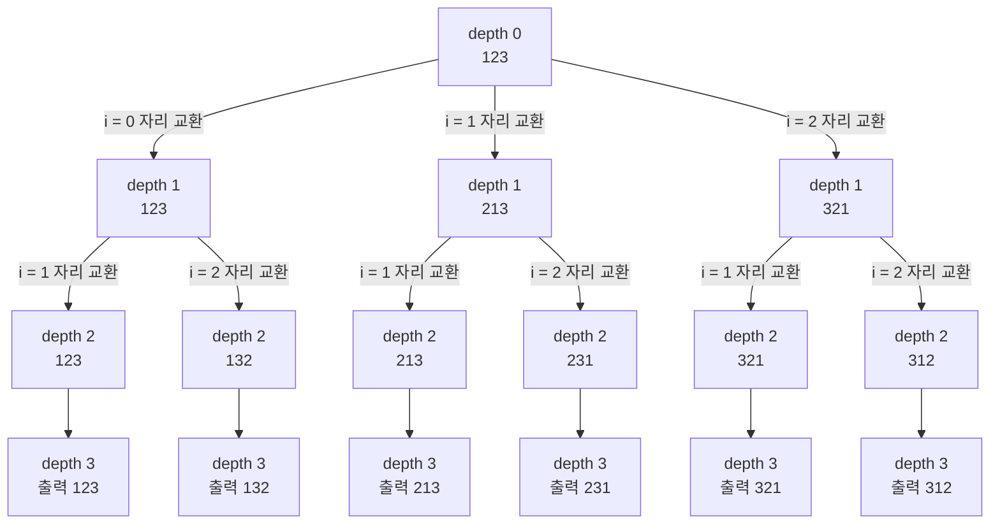

# TIL: 재귀를 이용한 순열

<br><br>

## 오늘 배운 내용

오늘은 배열의 원소를 서로 바꾸는 `swap()`과 재귀 호출을 이용해 순열을 만드는 방법을 배웠다.

순열은 주어진 원소들의 순서를 바꿔 만들 수 있는 모든 경우를 말한다. `{1, 2, 3}`의 순열은 `123`, `132`, `213`, `231`, `312`, `321`로 총 `3! = 6`개다.

코드에서는 `depth`를 현재 값을 정할 자리의 인덱스로 사용한다. `depth` 위치에 들어갈 원소를 하나씩 선택하고, 다음 위치를 재귀 호출로 채운다. 모든 위치가 정해지면 순열 하나가 완성된다.

<br>

## 재귀 순열의 흐름

아래 그림은 `n = 3`, `r = 3`일 때 재귀 함수가 진행되는 과정을 나타낸다.



> **그림을 볼 때 주의할 점:** `123`에서 0번 자리와 2번 자리의 값을 교환하면 `321`이 된다. 따라서 `depth = 1`의 오른쪽 첫 상태는 `312`가 아니라 `321`이다.

<br>

## 그래프를 따라가며 실행 순서 확인하기

이 그래프는 **위에서 아래로, 왼쪽에서 오른쪽으로** 보되, 실행은 한 갈래를 끝까지 내려간 뒤 되돌아오는 방식으로 따라간다. 이를 깊이 우선 탐색 방식으로 생각할 수 있다.

1. `depth = 0`에서 `i = 0`을 선택한다. 배열은 `123`이고, `depth = 1`로 들어간다.
2. `depth = 1`에서 `i = 1`을 선택한다. 배열은 여전히 `123`이고, `depth = 2`로 들어간다.
3. `depth = 2`에서 `i = 2`를 선택한다. `depth = 3`이 되면 `r == depth`이므로 `123`을 출력한다.
4. 함수가 돌아오면 `swap()`으로 배열을 원래대로 되돌린다. 그다음 같은 `depth = 1`에서 다음 선택인 `i = 2`를 시도해 `132`를 출력한다.
5. `depth = 1`의 선택을 모두 마치면 `depth = 0`으로 돌아온다. 원래대로 되돌린 뒤 다음 선택인 `i = 1`을 시도한다. 이 과정을 반복해 나머지 순열도 만든다.

따라서 그래프를 한 줄씩 전부 훑는 것이 아니라, **한 경로를 끝까지 내려가 순열을 출력하고, 한 단계씩 돌아오며 다음 갈래를 시도한다.**

<br>

## 재귀 순열 코드

```cpp
#include <bits/stdc++.h>
using namespace std;

int a[3] = {1, 2, 3};
int n = 3;
int r = 3;

void print()
{
    for (int i = 0; i < r; i++)
    {
        cout << a[i] << " ";
    }

    cout << "\n";
}

void makePermutation(int n, int r, int depth)
{
    // 필요한 자리를 모두 채웠으면 순열을 출력하고 종료한다.
    if (r == depth)
    {
        print();
        return;
    }

    // depth 자리에 들어갈 원소를 하나씩 선택한다.
    for (int i = depth; i < n; i++)
    {
        swap(a[i], a[depth]);

        // 다음 자리를 채우기 위해 한 단계 더 들어간다.
        makePermutation(n, r, depth + 1);

        // 다음 경우를 위해 배열을 원래 상태로 되돌린다.
        swap(a[i], a[depth]);
    }
}

int main()
{
    makePermutation(n, r, 0);
    return 0;
}
```

`makePermutation(n, r, 0)`으로 시작하므로 첫 번째 호출의 `depth`는 `0`이다.

`for`문은 현재 자리인 `depth`부터 마지막 인덱스까지 살펴본다. `swap(a[i], a[depth])`으로 현재 자리에 들어갈 값을 선택하고, `depth + 1`을 전달해 다음 자리를 정한다.

<br>

## 디버깅 코드

교환 전후에 출력문을 넣으면 재귀 호출의 진행 순서를 확인할 수 있다.

```cpp
void makePermutation(int n, int r, int depth)
{
    if (r == depth)
    {
        print();
        return;
    }

    for (int i = depth; i < n; i++)
    {
        cout << i << " : " << depth << "를 바꾼다!\n";

        swap(a[i], a[depth]);
        makePermutation(n, r, depth + 1);

        cout << i << " : " << depth << "를 다시 바꾼다!\n";

        swap(a[i], a[depth]);
    }
}
```

<br>

## 디버깅 출력 순서 따라가기

처음 두 순열이 만들어지는 동안의 주요 출력 순서는 다음과 같다.

```text
0 : 0를 바꾼다!
1 : 1를 바꾼다!
2 : 2를 바꾼다!
1 2 3
2 : 2를 다시 바꾼다!
1 : 1를 다시 바꾼다!
2 : 1를 바꾼다!
2 : 2를 바꾼다!
1 3 2
2 : 2를 다시 바꾼다!
2 : 1를 다시 바꾼다!
0 : 0를 다시 바꾼다!
```

이 출력은 그래프의 왼쪽 갈래부터 따라가면 이해할 수 있다.

- `0 : 0를 바꾼다!`가 출력되고 `depth = 1`로 들어간다.
- `1 : 1를 바꾼다!`가 출력되고 `depth = 2`로 들어간다.
- `2 : 2를 바꾼다!`가 출력되고 `depth = 3`으로 들어간다.
- `depth == r`이므로 `1 2 3`을 출력한다.
- 재귀 호출이 끝나면 먼저 `2 : 2를 다시 바꾼다!`가 출력된다. 이후 `depth = 2` 함수가 끝나고, `depth = 1` 함수로 돌아간다.
- `depth = 1`에서 다음 `i`인 `2`를 선택해 `1 3 2`를 만든다.
- 이 갈래도 끝나면 `depth = 0`으로 돌아가 `0 : 0를 다시 바꾼다!`를 실행한다.

`바꾼다!`는 재귀 호출로 들어가기 전에 출력되고, `다시 바꾼다!`는 재귀 호출에서 돌아온 뒤 출력된다. 이 순서를 통해 함수가 아래 단계로 들어가는 흐름과 위 단계로 돌아오는 흐름을 구분할 수 있다.

<br>

## 헷갈린 점과 해결 과정

- **`depth`는 무엇을 뜻할까?**  
  `depth`는 현재 값을 정하고 있는 자리의 인덱스다. 재귀가 한 단계 진행될 때마다 `depth`가 1씩 증가한다.

- **왜 `i`는 `depth`부터 시작할까?**  
  `depth`보다 앞에 있는 자리는 이미 정했기 때문이다. 이미 정한 자리는 그대로 두고, 아직 정하지 않은 자리 중에서 현재 자리에 들어갈 값을 선택한다.

- **왜 재귀 호출 뒤에 다시 `swap()`을 할까?**  
  재귀 호출을 마치고 돌아오면 다음 경우를 만들어야 한다. 이를 위해 교환했던 값을 원래 위치로 돌려놓는다. 이 과정을 백트래킹이라고 한다.

- **언제 재귀를 멈출까?**  
  `depth == r`이면 필요한 자리의 값을 모두 정한 상태다. 이때 순열을 출력하고 `return`으로 현재 호출을 끝낸다.

- **그래프는 어떤 순서로 읽을까?**  
  왼쪽에서 오른쪽으로 한 단계씩 훑는 것이 아니다. 한 갈래를 끝까지 내려가 순열을 출력하고, 재귀 호출에서 돌아온 뒤 다음 갈래를 선택한다.

<br>

## 실습 기록

강의 예제에 디버깅 출력문을 추가해 `makePermutation()`의 재귀 호출과 `swap()` 실행 순서를 살펴봤다. 출력문을 따라가며 한 갈래를 끝까지 진행한 뒤, 재귀 호출에서 돌아와 배열을 원래 상태로 복구하고 다음 갈래를 탐색하는 과정을 확인했다.

`n = 3`, `r = 3`으로 설정했을 때 다음 순열이 만들어진다.

```text
1 2 3
1 3 2
2 1 3
2 3 1
3 2 1
3 1 2
```

<br>

## 오늘 배운 내용 정리

재귀를 이용한 순열은 현재 자리 `depth`에 들어갈 원소를 하나씩 선택하고, 다음 자리를 재귀적으로 채우는 방법이다. `depth == r`이 되면 순열이 완성되어 출력한다.

그래프는 한 갈래를 끝까지 내려가며 따라간 뒤, 함수가 돌아오면 다음 갈래로 이동하는 순서로 읽는다. 재귀 호출 뒤 `swap()`으로 배열을 원래 상태로 되돌리는 과정이 있어야 다음 경우도 올바르게 만들 수 있다.
