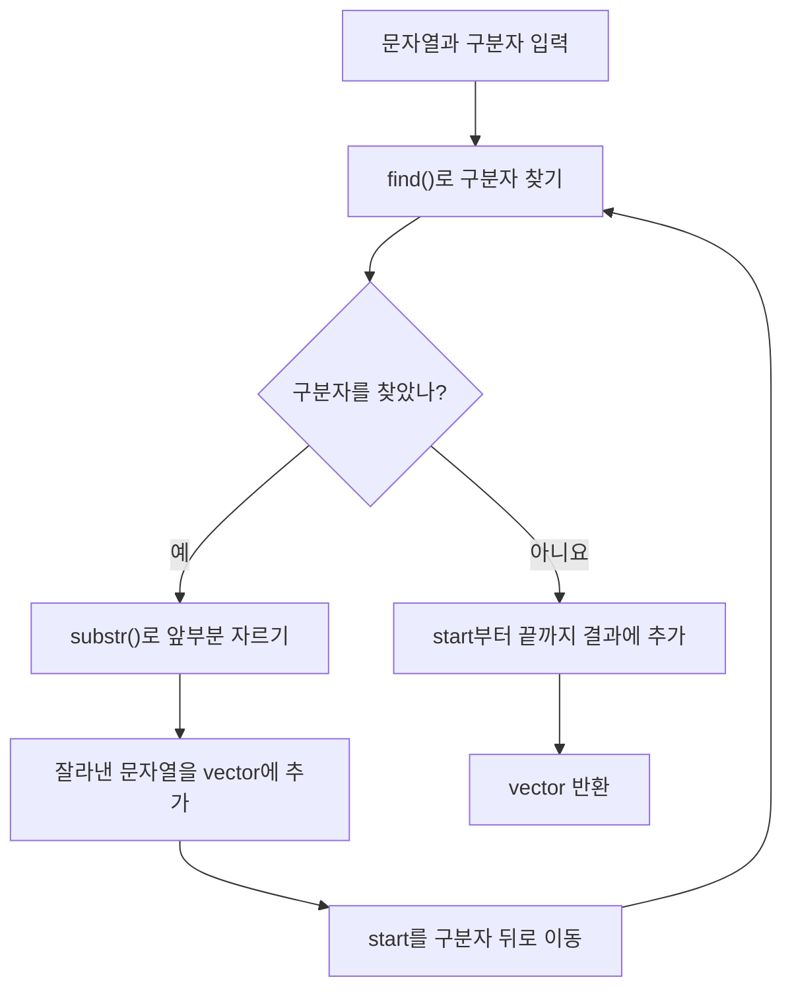

# TIL: C++ 문자열 `split()` 직접 구현하기

## 오늘 배운 내용

문자열에서 쉼표나 `->`처럼 정해 둔 구분 문자열을 기준으로 내용을 나누는 방법을 배웠다. 나눈 결과는 여러 개의 문자열이므로 `vector<string>`에 저장한다.

<br>

## 동작 과정 그림

`find()`로 구분 문자열을 찾고, `substr()`로 그 앞부분을 잘라 결과에 넣는다. 찾은 구분 문자열 뒤부터 다시 탐색하고, 더 이상 찾지 못하면 마지막 남은 문자열을 추가한다.


<br>

## 문자열 분리 과정을 따라가기

문자열 `apple,banana,orange,grape`를 쉼표 `,` 기준으로 나누면 다음과 같다.

| 차례 | `start` | 구분자 위치 `end` | 잘라서 추가하는 문자열 | 다음 `start` |
|---|---:|---:|---|---:|
| 1 | 0 | 5 | `apple` | 6 |
| 2 | 6 | 12 | `banana` | 13 |
| 3 | 13 | 19 | `orange` | 20 |
| 마지막 | 20 | `string::npos` | `grape` | 종료 |

```text
입력 문자열
apple,banana,orange,grape
^^^^^ ^^^^^^ ^^^^^^ ^^^^^
  1     2      3      4

구분 결과
["apple", "banana", "orange", "grape"]
```
<br>

## 코드 예시

```cpp
#include <iostream>
#include <string>
#include <vector>

using namespace std;

vector<string> split(const string& input, const string& delimiter)
{
    vector<string> result;

    // 빈 구분자는 검색 위치를 앞으로 옮기지 못하므로 따로 처리한다.
    if (delimiter.empty())
    {
        result.push_back(input);
        return result;
    }

    string::size_type start = 0;
    string::size_type end = input.find(delimiter, start);

    while (end != string::npos)
    {
        result.push_back(input.substr(start, end - start));

        start = end + delimiter.size();
        end = input.find(delimiter, start);
    }

    // 마지막 구분자 뒤에 남은 부분을 추가한다.
    result.push_back(input.substr(start));

    return result;
}

int main()
{
    string fruitText = "apple,banana,orange,grape";
    vector<string> fruits = split(fruitText, ",");

    for (const string& fruit : fruits)
    {
        cout << fruit << endl;
    }

    cout << "---" << endl;

    string numberText = "one->two->three->four";
    vector<string> numbers = split(numberText, "->");

    for (const string& number : numbers)
    {
        cout << number << endl;
    }

    return 0;
}
```

## 예상 결과

```text
apple
banana
orange
grape
---
one
two
three
four
```

<br>

## 핵심 함수와 변수

- `find(delimiter, start)`: `start` 위치부터 구분 문자열을 찾는다.
- `substr(start, length)`: 시작 위치와 길이를 기준으로 문자열을 잘라낸다.
- `start`: 다음 탐색을 시작할 위치다.
- `end`: 찾은 구분 문자열의 시작 위치다.
- `string::npos`: `find()`가 구분 문자열을 찾지 못했음을 나타낸다.
- `delimiter.size()`: 구분 문자열의 길이다. `,`처럼 한 글자뿐 아니라 `->`처럼 여러 글자인 경우에도 다음 위치를 정확히 계산할 수 있다.

<br>

## 헷갈린 점과 해결 과정

반복문 안에서 구분자를 찾은 부분만 결과에 추가하면 마지막 문자열이 빠질 수 있다. 그래서 반복문이 끝난 뒤 `input.substr(start)`를 한 번 더 결과에 추가한다.

구분자가 `->`처럼 여러 글자일 때는 다음 시작 위치를 한 칸만 이동하면 안 된다. 구분 문자열의 길이인 `delimiter.size()`만큼 이동해야 한다.

구분 문자열이 비어 있으면 검색 위치가 앞으로 이동하지 않아 반복이 끝나지 않을 수 있다. 이 예시에서는 빈 구분자일 때 원본 문자열 전체를 하나의 결과로 반환하도록 처리했다.

<br>

## 오늘 배운 내용 정리

`split()`은 구분 문자열을 찾아 문자열을 여러 조각으로 나누고, 각 조각을 `vector<string>`에 저장하는 함수다. `find()`로 위치를 찾고 `substr()`로 잘라낸 다음, `start`를 구분자 뒤로 옮겨 검색을 반복한다. 반복문이 끝난 뒤 마지막 남은 문자열도 추가해야 전체 결과가 완성된다.
