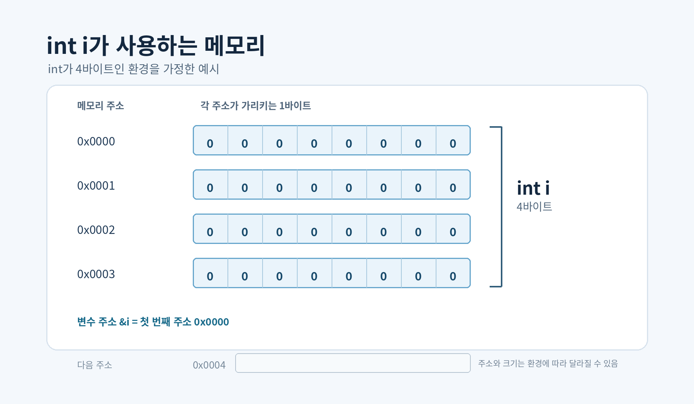
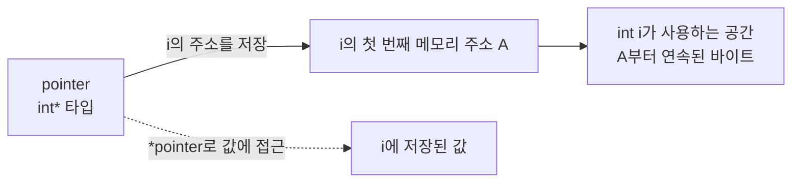

# TIL: 메모리와 포인터의 기초

## 오늘 배운 내용

변수를 선언하면 그 값을 저장할 메모리 공간이 필요하다. 메모리는 바이트 단위로 나뉘며, 각 바이트에는 주소가 있다.

예를 들어 `int`가 4바이트인 환경에서는 `int i`가 연속된 4바이트를 사용한다. 변수의 주소는 그중 **첫 번째 바이트의 주소**다. 실제 주소는 운영체제와 실행 상황에 따라 달라지므로, 강의 그림의 `0x0000`은 구조를 이해하기 위한 예시다.

<br>

## `int i`가 차지하는 메모리

아래 그림은 `int i`가 네 개의 1바이트 메모리 셀을 사용하는 모습을 나타낸다. 실제 컴퓨터에서 주소가 반드시 `0x0000`부터 시작한다는 뜻은 아니다.



예를 들어 `int i`의 첫 주소가 `A`라면 메모리 배치는 다음과 같이 생각할 수 있다.

| 주소 | `i`가 사용하는 부분 |
|---|---|
| `A` | 첫 번째 바이트 |
| `A + 1` | 두 번째 바이트 |
| `A + 2` | 세 번째 바이트 |
| `A + 3` | 네 번째 바이트 |

`int`의 크기는 시스템과 컴파일러에 따라 달라질 수 있다. 내 환경에서 실제 크기를 확인하려면 `sizeof(i)`를 확인하면 된다.

<br>

## 변수의 주소 확인하기

C++에서 변수 이름 앞에 `&`를 붙이면 그 변수의 주소를 얻을 수 있다. 여기서 `&`는 주소 연산자다.

```cpp
#include <iostream>

int i;

int main()
{
    std::cout << &i << '\n';

    i = 0;

    std::cout << &i << '\n';
    return 0;
}
```

`i`에 값을 대입해도 변수의 주소는 바뀌지 않는다. 주소는 `i`가 저장된 위치를 가리키고, 대입은 그 위치에 들어 있는 값만 바꾸기 때문이다.

위 코드에서 `i`는 함수 바깥에 선언된 전역 변수다. 전역 변수는 별도로 값을 대입하기 전에도 0으로 초기화된다.

<br>

## 포인터와 주소 연결하기

포인터는 메모리 주소를 저장하는 변수다. `int*`는 `int` 변수가 저장된 주소를 담을 수 있는 포인터 타입이다.

```cpp
#include <iostream>

int i;

int main()
{
    int* pointer = &i;

    std::cout << "i의 주소: " << &i << '\n';
    std::cout << "pointer에 저장된 주소: " << pointer << '\n';
    std::cout << "i의 값: " << i << '\n';

    i = 10;

    std::cout << "값을 바꾼 뒤 i의 주소: " << &i << '\n';
    std::cout << "값을 바꾼 뒤 i의 값: " << i << '\n';
    std::cout << "pointer로 읽은 값: " << *pointer << '\n';

    return 0;
}
```

<br>

### 포인터 관계 그림



- `&i`: 변수 `i`의 주소를 구한다.
- `pointer`: `i`의 주소를 저장한다.
- `*pointer`: 포인터가 가리키는 주소에 있는 값에 접근한다.
- `i = 10`: 메모리 위치는 그대로 두고 그 위치에 저장된 값을 바꾼다.

주소 출력은 실행할 때마다 달라질 수 있다. 하지만 같은 실행 중에는 `i`에 새 값을 대입해도 `i`의 주소는 그대로 유지된다.

<br>

## 헷갈린 점과 해결 과정

`i`에 다른 값을 넣으면 주소도 바뀌는지 헷갈릴 수 있다. 변수의 주소는 값이 저장된 메모리 위치이고, 대입은 그 위치의 내용을 바꾸는 동작이다. 그래서 값이 바뀌어도 주소는 그대로다.

또한 `&i`와 `*pointer`의 의미를 혼동하기 쉽다. `&i`는 주소를 구하고, `*pointer`는 포인터가 가진 주소를 따라가 그곳의 값을 읽거나 변경한다.

<br>

## 오늘 배운 내용 정리

변수는 메모리에 값을 저장하고, 변수의 주소는 그 메모리 공간의 시작 위치를 가리킨다. 포인터는 그 주소를 저장하는 변수다. `&`로 주소를 얻고 `*`로 포인터가 가리키는 값에 접근할 수 있다.
