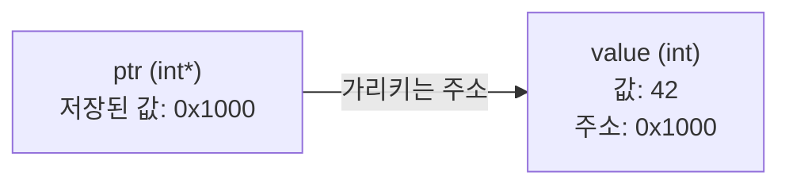

# TIL: C++ 포인터와 메모리 주소

## 오늘 배운 내용

포인터는 **변수의 메모리 주소를 저장하는 변수**다. 일반 변수에 값이 들어간다면, 포인터에는 다른 변수가 있는 위치를 가리키는 주소가 들어간다.

포인터를 이해할 때는 다음 두 기호를 구분하면 된다.

- `&변수`: 변수의 메모리 주소를 가져온다.
- `*포인터`: 포인터가 가리키는 주소에 있는 값을 읽거나 수정한다.

<br>

### 포인터를 그림으로 이해하기



위 그림에서 `ptr`에는 정수 `42`가 직접 들어 있는 것이 아니다. `ptr`은 `value`가 저장된 주소를 가지고 있고, `*ptr`을 사용하면 그 주소에 있는 값인 `42`에 접근할 수 있다.

`0x1000`은 구조를 설명하기 위해 사용한 가상의 주소다. 실제 주소는 실행할 때마다 달라질 수 있다.

---
<br>

## 포인터 선언과 사용

포인터는 가리키는 데이터의 타입에 맞춰 선언해야 한다. `double`형 변수의 주소를 저장하려면 `double*` 포인터를 사용한다.

```cpp
#include <iostream>

int main()
{
    double a = 0.12;
    double* b = &a;

    std::cout << "a: " << a << '\n';
    std::cout << "*b: " << *b << '\n';

    *b = 0.5;

    std::cout << "a after changing *b: " << a << '\n';

    return 0;
}
```
<br>

### 출력 예시

```text
a: 0.12
*b: 0.12
a after changing *b: 0.5
```

`b`는 `double`형 변수 `a`의 주소를 저장하므로 `double*`로 선언해야 한다. `*b`는 그 주소에 저장된 `double`형 값에 접근한다. 따라서 `double` 변수를 가리키는 포인터의 타입도 `double*`이어야 한다.

```cpp
double a = 0.12;
double* b = &a; // 올바른 선언
```

다음처럼 `int*`로 선언하면 타입이 맞지 않아 컴파일 오류가 발생한다.

```cpp
double a = 0.12;
int* b = &a; // 오류: int* 포인터에 double 변수의 주소를 저장할 수 없음
```

즉, `int`형 변수를 가리키려면 `int*`, `double`형 변수를 가리키려면 `double*`를 사용한다.

---

<br>

## `&`와 `*`의 역할

| 표현 | 의미 |
|---|---|
| `&value` | `value`의 주소를 가져온다 |
| `int* ptr` | `int`형 데이터를 가리키는 포인터를 선언한다 |
| `*ptr` | `ptr`이 가리키는 곳에 저장된 값에 접근한다 |

`*`는 쓰이는 위치에 따라 의미가 달라진다.

```cpp
int* ptr = &value; // 선언에서 *는 포인터 타입을 나타냄
int result = *ptr; // 식에서 *는 포인터가 가리키는 값을 가져옴
```

---
<br>

## 포인터의 크기

포인터의 크기는 포인터가 가리키는 데이터 타입의 크기와 같지 않다.

예를 들어 `char`는 보통 1바이트지만, `char*` 포인터의 크기가 반드시 1바이트인 것은 아니다. 포인터는 데이터 자체가 아니라 **메모리 주소**를 저장하기 때문이다.

포인터 크기는 실행 환경의 ABI와 플랫폼에 따라 달라진다. 흔히 32비트 환경에서는 4바이트, 64비트 환경에서는 8바이트인 경우가 많지만, 이를 모든 환경에 적용되는 규칙으로 단정하면 안 된다.

```cpp
std::cout << sizeof(ptr) << '\n';
```

`sizeof(ptr)`를 사용하면 현재 프로그램에서 해당 포인터 변수가 차지하는 크기를 확인할 수 있다. `int*`, `char*`, `std::string*`의 크기가 항상 각각의 데이터 크기와 같지는 않다.

---
<br>

## 포인터가 사용되는 곳

포인터는 여러 상황에서 사용된다.

- 동적으로 만든 객체나 데이터에 접근할 때
- 큰 데이터를 복사하지 않고 함수에 전달할 때
- 클래스나 구조체 사이의 연결을 표현할 때
- 자료구조에서 다음 노드나 이전 노드를 가리킬 때

예를 들어 연결 리스트의 노드는 다음 노드를 가리키는 포인터를 가질 수 있다.

```cpp
struct Node
{
    int data;
    Node* next;
};
```

`next`는 다음 노드의 주소를 저장한다. 이런 방식으로 각 노드를 연결해 여러 데이터를 이어진 구조로 표현할 수 있다.

---
<br>

## 메모리 관리와 포인터

Java, Python, JavaScript 같은 언어는 일반적으로 가비지 컬렉터가 더 이상 사용하지 않는 메모리를 회수하도록 돕는다. C++에는 언어 자체가 항상 자동으로 메모리를 회수해 주는 가비지 컬렉터가 기본으로 포함되어 있지 않다.

다만 C++에서 메모리 관리를 전부 개발자가 `new`와 `delete`로 직접 해야 한다고 이해하면 정확하지 않다. C++에서는 객체의 수명에 따라 자원을 정리하는 **RAII**와 `std::unique_ptr`, `std::shared_ptr` 같은 **스마트 포인터**를 자주 사용해 메모리와 자원을 관리한다.

---
<br>

## 헷갈린 점과 주의할 점

### 포인터 변수와 가리키는 값은 다르다

```cpp
int value = 42;
int* ptr = &value;
```

- `ptr`: `value`의 주소를 저장한다.
- `*ptr`: 그 주소에 있는 값인 `42`에 접근한다.

### 이미 사라진 객체의 주소를 사용하지 않는다

가리키던 객체의 수명이 끝났는데 포인터를 계속 사용하면, 잘못된 메모리에 접근할 수 있다. 이런 포인터를 댕글링 포인터라고 한다.

포인터를 사용할 때는 **가리키는 대상이 살아 있는지**, **현재 주소가 유효한지** 확인해야 한다.

---
<br>

## 오늘 배운 내용 정리

포인터는 다른 변수의 메모리 주소를 저장하는 변수다. `&`로 변수의 주소를 얻고, `*`로 포인터가 가리키는 값에 접근한다. 포인터 크기는 가리키는 데이터 타입의 크기가 아니라 실행 환경에 따라 정해진다. 포인터는 연결 자료구조나 객체 접근 등에 쓰이며, C++에서는 `nullptr`, 객체의 수명, RAII와 스마트 포인터를 함께 이해하는 것이 중요하다.
