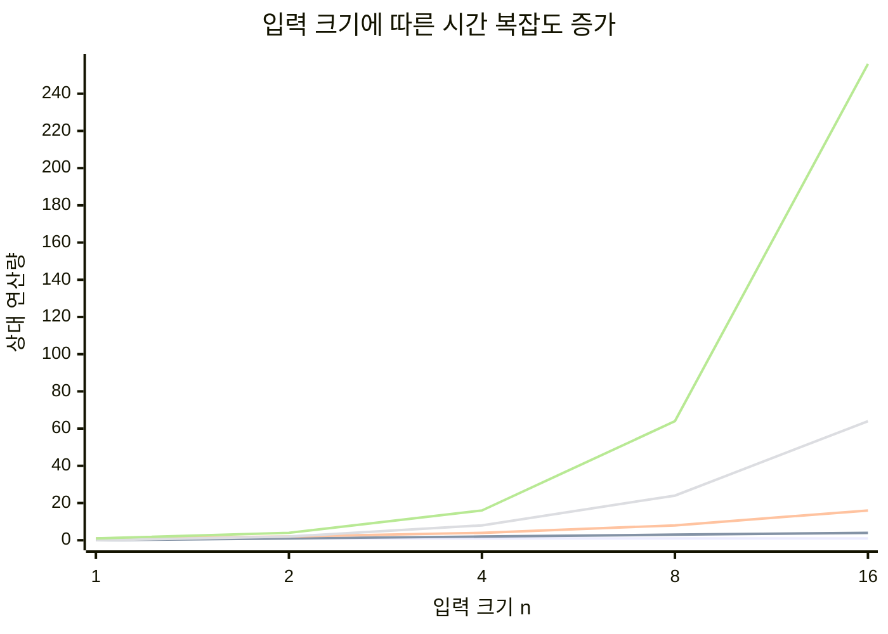

# TIL: 시간 복잡도와 빅오 표기법

## 오늘의 학습 목표

오늘은 코드의 입력 크기가 커질 때 연산량이 어떻게 증가하는지 살펴보고, 이를 빅오 표기법으로 표현하는 방법을 배웠다.

특히 다음 내용을 정리했다.

- 시간 복잡도의 의미
- 가장 큰 영향을 주는 항을 찾아 빅오 표기법으로 나타내는 방법
- 시간 복잡도별 증가 속도 비교
- 상수 시간 복잡도 `O(1)`의 의미와 예시

<br>

## 시간 복잡도란?

시간 복잡도는 입력 크기가 커질 때 프로그램이 수행하는 연산량이 어떻게 증가하는지 나타내는 기준이다.

프로그램의 실제 실행 시간은 컴퓨터 성능이나 실행 환경에 따라 달라질 수 있다. 그래서 알고리즘을 비교할 때는 실제 초 단위 실행 시간보다, 입력 크기 `n`에 따라 연산량이 어떻게 증가하는지를 살펴본다.

예를 들어 입력 데이터가 `n`개일 때 다음과 같은 코드가 있다고 하자.

```cpp
for (int i = 0; i < n; i++)
{
    for (int j = 0; j < n; j++)
    {
        // 한 번의 기본 연산
    }
}
```

바깥 반복문이 `n`번 실행되고, 각 실행마다 안쪽 반복문도 `n`번 실행된다. 따라서 전체 연산 횟수는 대략 `n × n`, 즉 `n²`에 비례한다.

<br>

## 빅오 표기법이란?

빅오 표기법(Big-O notation)은 입력 크기가 커질 때 알고리즘의 연산량이 어떤 속도로 증가하는지 나타내는 표기법이다.

시간 복잡도를 계산할 때는 보통 다음과 같이 정리한다.

1. 입력 크기 `n`에 따라 반복되는 연산을 식으로 나타낸다.
2. 가장 빠르게 증가하는 항을 찾는다.
3. 그 항의 상수 계수를 제외한다.
4. 그보다 느리게 증가하는 항을 제외한다.

예를 들어 시간 복잡도가 다음과 같다고 하자.

```text
10n² + n
```

`n`이 커질수록 `n²` 항은 `n` 항보다 훨씬 빠르게 증가한다. `n²`의 계수인 `10`도 빅오 표기법에서는 제외하므로 다음과 같이 나타낸다.

```text
10n² + n  →  O(n²)
```

따라서 이 코드의 시간 복잡도는 `O(n²)`이다.

### `10n² + n²`도 `O(n²)`인 이유

같은 차수의 항은 먼저 더한다.

```text
10n² + n² = 11n²
```

빅오 표기법에서는 상수 계수 `11`을 제외한다.

```text
11n²  →  O(n²)
```

<br>

## 입력 크기에 따른 항의 증가 비교

`n`이 `1`, `3`, `9`, `12`로 증가한다고 할 때 `n`과 `n²`의 값은 다음과 같다.

| 입력 크기 `n` | `n` | `n²` |
|---:|---:|---:|
| 1 | 1 | 1 |
| 3 | 3 | 9 |
| 9 | 9 | 81 |
| 12 | 12 | 144 |

`n`이 커질수록 `n²`은 `n`보다 빠르게 증가한다. 그래서 `10n² + n`처럼 `n²` 항과 `n` 항이 함께 있을 때, 전체 증가 속도에는 `n²` 항이 가장 큰 영향을 준다.

예를 들어 `n = 12`라면 다음과 같다.

```text
10n² + n
= 10 × 144 + 12
= 1452
```

이 식에서 `10n²` 항은 `1440`, `n` 항은 `12`다. 입력 크기가 더 커질수록 `n²` 항이 차지하는 비중은 더 커진다.

<br>

## 시간 복잡도 증가 순서

입력 크기가 충분히 커질 때, 일반적으로 시간 복잡도는 다음 순서로 빠르게 증가한다.

```text
O(1) < O(log n) < O(n) < O(n log n) < O(n²) < O(2ⁿ) < O(n!)
```

왼쪽일수록 입력 크기가 커져도 연산량이 천천히 증가하고, 오른쪽일수록 빠르게 증가한다.

| 시간 복잡도 | 이름 | 증가 형태의 예 |
|---|---|---|
| `O(1)` | 상수 시간 | 입력 크기와 관계없이 일정 |
| `O(log n)` | 로그 시간 | 입력을 반복해서 나누는 경우 |
| `O(n)` | 선형 시간 | 입력을 한 번씩 확인하는 경우 |
| `O(n log n)` | 선형 로그 시간 | 효율적인 정렬 알고리즘에서 자주 나타남 |
| `O(n²)` | 이차 시간 | 중첩 반복문에서 자주 나타남 |
| `O(2ⁿ)` | 지수 시간 | 선택지가 단계마다 두 배로 늘어나는 경우 |
| `O(n!)` | 팩토리얼 시간 | 가능한 모든 순서를 확인하는 경우 |

이 순서는 모든 작은 입력값에서 항상 값의 크기가 엄격하게 일치한다는 뜻은 아니다. 입력 크기가 커질 때 각 함수가 얼마나 빠르게 증가하는지를 비교한 것이다.

<br>

### 시간 복잡도 증가 차트

아래 차트는 각 복잡도 함수의 값이 입력 크기에 따라 어떻게 증가하는지 비교한다. 실제 실행 시간이나 특정 컴퓨터의 성능을 나타내는 차트는 아니다.



차트에서 `O(1)`은 입력 크기가 증가해도 높이가 거의 변하지 않는다. `O(n)`은 입력 크기에 비례해 증가하고, `O(n²)`은 입력 크기가 커질수록 훨씬 빠르게 증가한다.

<br>

## 상수 시간 복잡도 `O(1)`

상수 시간 복잡도는 입력 크기와 관계없이 연산 횟수가 일정한 경우를 말한다. 빅오 표기법으로는 `O(1)`이라고 쓴다.

여기서 “일정하다”는 말은 프로그램 전체가 항상 똑같은 시간에 끝난다는 뜻이 아니다. 입력 크기 `n`이 커져도 해당 작업의 연산 횟수가 늘어나지 않는다는 뜻이다.


### 배열의 인덱스로 원소 하나에 접근하기

```cpp
int value = numbers[2];
```

배열의 크기가 10개든 100만 개든, `numbers[2]`처럼 특정 인덱스에 접근하는 작업은 같은 방식으로 원소를 찾는다. 따라서 배열의 인덱스 접근은 `O(1)`이다.

### 간단한 산술 연산

```cpp
numbers[2] *= 2;
```

고정 크기 정수에 대한 곱셈, 나눗셈, 나머지, 덧셈, 뺄셈 등의 기본 연산은 일반적인 시간 복잡도 분석에서 `O(1)`로 본다.

### 간단한 비교와 조건 검사

```cpp
if (numbers[2] == 2)
{
    // 조건이 참일 때 실행
}
```

배열의 특정 원소를 한 번 확인하는 비교는 입력 크기와 관계없이 한 번 수행되므로 `O(1)`이다. 단, 조건문 안에 반복문이 있다면 그 반복문까지 따로 분석해야 한다.

### 값 하나 입력하거나 출력하기

```cpp
int number;

std::cin >> number;
std::cout << number;
```

고정 크기 정수 값 하나를 입력하거나 출력하는 작업은 기본적인 분석에서 각각 `O(1)`로 볼 수 있다.

단, 입력값이 `n`개라면 전체 입력 작업은 `O(n)`이 된다. 문자열처럼 입력 데이터의 길이가 `L`인 경우에는 문자열 전체를 읽거나 출력하는 작업이 보통 `O(L)`이다.

<br>

## 상수 시간과 선형 시간 비교

배열에서 원소 하나만 확인하는 경우와 모든 원소를 확인하는 경우는 시간 복잡도가 다르다.

### 원소 하나만 확인하기: `O(1)`

```cpp
int value = numbers[2];
```

배열의 다른 원소가 얼마나 많든 세 번째 원소 하나에 접근한다.

### 모든 원소 확인하기: `O(n)`

```cpp
for (int i = 0; i < n; i++)
{
    std::cout << numbers[i] << '\n';
}
```

반복문이 입력 크기 `n`만큼 실행된다. `n`이 두 배가 되면 반복 횟수도 두 배가 되므로 시간 복잡도는 `O(n)`이다.

<br>

## 오늘 배운 내용 정리

- 시간 복잡도는 입력 크기가 증가할 때 연산량이 어떻게 증가하는지 나타낸다.
- 빅오 표기법은 알고리즘의 증가 속도를 표현한다.
- `10n² + n`에서는 가장 빠르게 증가하는 `n²` 항을 남기고 상수 계수와 낮은 차수 항을 제외해 `O(n²)`로 나타낸다.
- `10n² + n²`은 `11n²`이고, 상수 계수를 제외하면 `O(n²)`이다.
- 시간 복잡도는 일반적으로 `O(1)`, `O(log n)`, `O(n)`, `O(n log n)`, `O(n²)`, `O(2ⁿ)`, `O(n!)` 순서로 빠르게 증가한다.
- 배열 인덱스 접근, 고정 크기 값 하나의 산술 연산과 비교는 `O(1)`이다.
- 값 하나를 입력하는 것과 `n`개의 값을 모두 입력하는 것은 다르다. `n`개를 처리하면 전체 작업은 보통 `O(n)`이다.

<br>

## 헷갈렸던 점과 해결 과정

- **`10n² + n`에서 `n` 항도 계산해야 하는 것 아닌가?** 식을 계산할 때는 `n` 항도 포함된다. 하지만 입력 크기가 커질수록 `n²` 항이 `n` 항보다 훨씬 빠르게 증가하므로, 증가 속도를 나타내는 빅오 표기에서는 `n²`만 남겨 `O(n²)`로 표현한다.
- **상수 계수 `10`은 왜 제외하는가?** `10n²`와 `n²`은 모두 입력 크기가 커질 때 `n²`에 비례해 증가한다. 상수 배수는 증가하는 차수를 바꾸지 않으므로 빅오 표기에서 제외한다.
- **`cin`과 `cout`은 언제나 `O(1)`인가?** 고정 크기 값 하나를 입력하거나 출력하는 작업을 분석할 때는 `O(1)`로 볼 수 있다. 하지만 `n`개 값을 읽거나 길이가 `L`인 문자열을 처리하면 전체 작업량도 함께 증가한다.
- **`n! > 2ⁿ > n²`는 모든 입력값에 항상 성립하는가?** 이 순서는 작은 입력값 하나하나를 비교하는 규칙이 아니라, 입력 크기가 커질수록 각 함수가 증가하는 속도를 비교한 것이다.

<br>

## 참고 자료

- 오늘 배운 수업 내용을 바탕으로 정리했다.
- Mermaid 차트 문법: [XY Chart 공식 문서](https://mermaid.js.org/syntax/xyChart)
