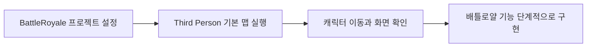

# TIL: 언리얼 배틀로얄 프로젝트 시작

  

## 오늘 한 일

언리얼 엔진으로 배틀로얄 게임을 만들기 위해 `BattleRoyale` 프로젝트를 준비하고, 실행 화면에서 기본 동작을 확인했다. 앞으로 배틀그라운드의 기능을 참고해 게임 기능을 하나씩 직접 구현해 볼 계획이다.

 

## 프로젝트 설정 화면 분석

아래 이미지는 언리얼 프로젝트 브라우저에서 새 프로젝트를 설정한 화면이다.

화면에서 다음 설정을 확인했다.

- 언리얼 엔진 버전: 5.3.2
- 템플릿: Third Person
- 프로젝트 유형: C++
- 타깃 플랫폼: Desktop
- 퀄리티 프리셋: Maximum
- 프로젝트 이름: `BattleRoyale`
- 시작용 콘텐츠: 선택하지 않음
- 레이 트레이싱: 선택하지 않음

Third Person 템플릿에는 3인칭 캐릭터와 카메라, 기본 이동 기능이 포함되어 있다. 이 프로젝트를 바탕으로 배틀로얄 게임에 필요한 기능을 추가해 나갈 수 있다, 또한 위에 초록색 세모를 통해 PIE(Play In Editor) 언리얼 에디터 안에서 게임을 직접 실행해 볼 수 있는 기능이다 .

 

## ThirdPersonCharacter 확인

Third Person 템플릿에서 기본 캐릭터인 `ThirdPersonCharacter`를 실행해 조작해 봤다.

[언리얼 시작 화면 영상 보기](<../assets/프로젝트 개요/언리얼 시작화면.mp4>)

- `W`, `A`, `S`, `D` 키로 캐릭터를 이동할 수 있다.
- 스페이스바를 눌러 점프할 수 있다.
- 캐릭터가 이동하거나 점프할 때 기본 애니메이션이 재생된다.
- 카메라가 캐릭터를 따라가며 3인칭 시점으로 보여준다.

이 기본 캐릭터와 조작 기능은 언리얼 엔진의 Third Person 템플릿에서 제공한다.

 

## 시작용 콘텐츠를 선택하지 않은 이유

시작용 콘텐츠에는 기본 메시와 머티리얼 같은 예제 에셋이 포함된다. 이번 프로젝트에서는 필요한 에셋을 직접 골라 정리하며 개발하고 싶어서 선택하지 않았다.

이렇게 하면 프로젝트를 시작할 때 사용하지 않을 예제 에셋이 함께 들어오지 않아 콘텐츠를 직접 관리하기 쉽다. 개발 중 필요한 에셋이 생기면 나중에 별도로 추가할 수 있다.

 

## 개발 도구 계획

C++ 코드 작성과 프로젝트 탐색에는 **JetBrains Rider**를 사용할 계획이다. 코드 구조를 살펴보고, 수정하거나 빌드할 때 생기는 오류를 확인하는 데 활용하려고 한다.

**Claude**는 코드 설명과 구현 아이디어 정리, 오류 원인 파악을 돕는 개발 보조 도구로 사용할 예정이다. 제안된 코드를 그대로 복사하기보다 동작을 이해한 뒤 프로젝트에서 확인하며 적용할 계획이다.

 

## 앞으로 만들 게임

배틀그라운드의 게임 기능을 참고해 배틀로얄 형식의 게임을 만들어 볼 계획이다. 기본 캐릭터와 프로젝트 구조를 확인한 다음, 기능을 하나씩 추가하고 실행해 결과를 확인하려고 한다.

앞으로 구현해 볼 기능은 다음과 같다.

- 캐릭터 이동과 카메라 조작
- 무기 획득, 발사, 재장전
- 체력과 피해 처리
- 아이템 획득과 관리
- 자기장과 경기 진행 흐름

 

## 실습 기록

오늘은 언리얼 프로젝트의 템플릿과 개발 유형을 설정하고, `BattleRoyale` 프로젝트를 실행해 기본 맵과 캐릭터를 확인했다. 영상에서 캐릭터 이동, 체력 표시, 자기장 카운트다운 표시도 살펴봤다.

이번 기록에서는 새로운 C++ 코드를 작성하지 않았다. 프로젝트 생성 설정과 실행 화면에서 확인한 내용을 정리했다.

  

## 오늘 배운 내용 정리

오늘은 언리얼 엔진에서 Third Person C++ 프로젝트를 설정하고 실행 화면을 확인했다. 프로젝트 생성 화면에서는 `BattleRoyale`이라는 이름과 C++ 유형을 선택했고, 시작용 콘텐츠는 프로젝트를 필요한 에셋 중심으로 관리하기 위해 선택하지 않았다.

실행 영상에서는 기본 맵에서 캐릭터가 이동하고 카메라가 따라오는 모습, 체력 표시, 시간이 줄어드는 자기장 카운트다운 UI를 확인했다. 앞으로 JetBrains Rider와 Claude를 활용해 배틀그라운드의 기능을 참고한 배틀로얄 게임을 하나씩 구현해 나갈 계획이다.
