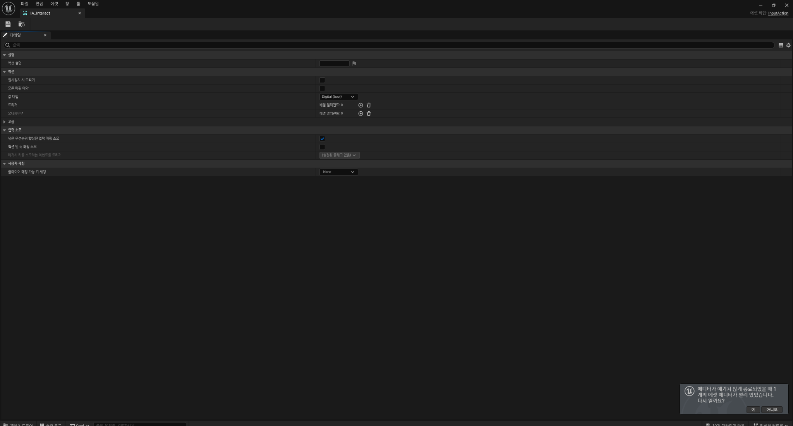

# TIL: 언리얼 엔진 C++ 무기 줍기 기능 구현

## 오늘 만든 기능

오늘은 캐릭터가 바닥에 놓인 무기에 가까이 가면 `E 줍기` 안내가 나타나고, E 키를 누르면 무기가 캐릭터 손에 장착되는 기능을 만들었다.

무기의 줍기 범위 감지, 상호작용 가능 여부 확인, 안내 UI 표시, 입력 처리, 무기 장착을 각각 나누어 구현했다.

---

<br>

## 전체 동작 흐름

1. `IA_Interact` 입력 액션을 만들고 E 키에 연결한다.
2. 무기에 `PickupSphere`를 추가해 근처의 캐릭터를 감지한다.
3. 캐릭터가 범위 안에 들어오면 무기를 주변 상호작용 대상 목록에 등록한다.
4. 캐릭터가 무기를 주울 수 있는 상태인지 확인한다.
5. 주울 수 있는 무기가 있으면 `E 줍기` 안내를 표시한다.
6. E 키를 누르면 무기를 캐릭터의 `WeaponSocket`에 부착한다.
7. 장착한 무기의 바닥 충돌과 물리 시뮬레이션을 끈다.

---

<br>

## 1. E 키 입력 설정

먼저 `IA_Interact` 입력 액션을 만들었다. 이 액션은 캐릭터가 상호작용을 시도할 때 사용할 입력이다.



`IMC_Default`에서 `IA_Interact`를 E 키에 연결했다. 캐릭터 블루프린트의 `Interact Action` 속성에도 이 입력 액션을 지정했다.


---

<br>

## 2. 상호작용 인터페이스 만들기

`IInteractable` 인터페이스에 상호작용 가능 여부를 확인하는 함수와 실제 상호작용을 시도하는 함수를 선언했다.

```cpp
#pragma once // 헤더가 여러 번 포함되는 것을 방지한다.

#include "CoreMinimal.h" // 언리얼 엔진의 기본 타입과 기능을 사용한다.
#include "UObject/Interface.h" // 언리얼 인터페이스의 기반 클래스를 포함한다.
#include "Interactable.generated.h" // 언리얼 헤더 도구가 생성한 코드를 포함한다.

class ABattleRoyaleCharacter; // 캐릭터 클래스를 미리 선언한다.

UINTERFACE(MinimalAPI) // 언리얼 리플렉션에 사용할 인터페이스 클래스를 선언한다.
class UInteractable : public UInterface
{
	GENERATED_BODY() // 언리얼 인터페이스에 필요한 코드를 생성한다.
};

class IInteractable // C++에서 구현할 상호작용 인터페이스를 선언한다.
{
	GENERATED_BODY() // 언리얼 인터페이스에 필요한 코드를 생성한다.

public:
	virtual bool CanInteract( // 상호작용이 가능한지 확인하는 함수를 선언한다.
		const ABattleRoyaleCharacter* Character) const = 0;

	virtual bool TryInteract( // 상호작용을 시도하고 성공 여부를 반환하는 함수를 선언한다.
		ABattleRoyaleCharacter* Character) = 0;
};
```

`CanInteract()`는 현재 캐릭터가 대상과 상호작용할 수 있는지 확인한다. `TryInteract()`는 실제 상호작용을 시도하고 성공 여부를 반환한다.

---

<br>

## 3. 무기에 줍기 범위 추가하기

`AWeaponBase`가 `IInteractable` 인터페이스를 구현하도록 선언하고, 무기 메시와 줍기 구체를 멤버로 추가했다.

### `WeaponBase.h`에 추가한 선언

```cpp
#include "Interactable.h" // 무기 클래스가 상호작용 인터페이스를 구현할 수 있게 포함한다.

class ABattleRoyaleCharacter; // 캐릭터 클래스를 미리 선언한다.
class USphereComponent; // 줍기 범위 구체 클래스를 미리 선언한다.
class UStaticMeshComponent; // 무기 메시 클래스를 미리 선언한다.
class UPrimitiveComponent; // 겹침 이벤트의 컴포넌트 타입을 미리 선언한다.

UPROPERTY(VisibleAnywhere, BlueprintReadOnly, Category = Weapon)
UStaticMeshComponent* WeaponMesh; // 화면에 보이는 무기 메시를 저장한다.

UPROPERTY(VisibleAnywhere, BlueprintReadOnly, Category = Weapon)
USphereComponent* PickupSphere; // 무기 주변의 줍기 감지 범위를 저장한다.

virtual bool CanInteract( // 무기를 주울 수 있는 상태인지 확인한다.
	const ABattleRoyaleCharacter* Character) const override;

virtual bool TryInteract( // 무기를 실제로 주우려고 시도한다.
	ABattleRoyaleCharacter* Character) override;

void OnPickedUp(); // 무기를 주운 뒤 충돌과 물리를 정리한다.

UFUNCTION() // 언리얼 겹침 이벤트에 연결할 함수임을 표시한다.
void OnPickupSphereBeginOverlap( // 캐릭터가 줍기 범위에 들어왔을 때 실행된다.
	UPrimitiveComponent* OverlappedComponent,
	AActor* OtherActor,
	UPrimitiveComponent* OtherComp,
	int32 OtherBodyIndex,
	bool bFromSweep,
	const FHitResult& SweepResult);

UFUNCTION() // 언리얼 겹침 이벤트에 연결할 함수임을 표시한다.
void OnPickupSphereEndOverlap( // 캐릭터가 줍기 범위에서 나갔을 때 실행된다.
	UPrimitiveComponent* OverlappedComponent,
	AActor* OtherActor,
	UPrimitiveComponent* OtherComp,
	int32 OtherBodyIndex);
```

### `WeaponBase.cpp`의 생성자

`PickupSphere`를 무기 메시의 자식 컴포넌트로 만들고, 반지름을 100으로 설정했다. `Trigger` 충돌 프로필과 겹침 이벤트를 사용해 캐릭터가 가까이 왔는지 감지한다.

```cpp
#include "WeaponBase.h" // 무기 클래스의 선언을 포함한다.
#include "BattleRoyaleCharacter.h" // 겹친 액터를 캐릭터로 변환할 때 사용한다.
#include "Components/CapsuleComponent.h" // 캐릭터 캡슐 컴포넌트를 확인할 때 사용한다.
#include "Components/SphereComponent.h" // 줍기 범위 구체를 생성할 때 사용한다.
#include "Components/StaticMeshComponent.h" // 무기 메시를 생성할 때 사용한다.

AWeaponBase::AWeaponBase() // 무기 액터의 기본 컴포넌트와 값을 설정한다.
{
	PrimaryActorTick.bCanEverTick = false; // 매 프레임 실행할 Tick을 사용하지 않는다.

	WeaponMesh =
		CreateDefaultSubobject<UStaticMeshComponent>(
			TEXT("WeaponMesh")); // 무기 메시 컴포넌트를 만든다.

	RootComponent = WeaponMesh; // 무기 메시를 액터의 루트로 설정한다.

	PickupSphere =
		CreateDefaultSubobject<USphereComponent>(
			TEXT("PickupSphere")); // 줍기 범위를 감지할 구체를 만든다.

	PickupSphere->SetupAttachment(WeaponMesh); // 구체를 무기 메시 아래에 붙인다.
	PickupSphere->InitSphereRadius(100.f); // 줍기 감지 반지름을 100으로 설정한다.
	PickupSphere->SetCollisionProfileName(TEXT("Trigger")); // 충돌 프로필을 겹침 감지용으로 설정한다.
	PickupSphere->SetGenerateOverlapEvents(true); // 겹침 이벤트를 발생시킨다.
}
```


충돌 설정에서는 무기 메시와 줍기 구체의 역할을 구분했다. 무기 메시가 물체의 충돌을 담당하고, `PickupSphere`는 캐릭터가 범위에 들어왔는지 감지한다.


---

<br>

## 4. 줍기 범위 진입과 이탈 처리

`BeginPlay()`에서 줍기 구체의 시작 겹침과 종료 겹침 이벤트를 함수에 연결했다.

```cpp
void AWeaponBase::BeginPlay() // 액터가 게임에 배치된 뒤 초기 설정을 한다.
{
	Super::BeginPlay(); // 부모 클래스의 BeginPlay를 먼저 실행한다.

	PickupSphere->OnComponentBeginOverlap.AddDynamic( // 구체에 들어왔을 때 호출할 함수를 연결한다.
		this,
		&AWeaponBase::OnPickupSphereBeginOverlap);

	PickupSphere->OnComponentEndOverlap.AddDynamic( // 구체에서 나갔을 때 호출할 함수를 연결한다.
		this,
		&AWeaponBase::OnPickupSphereEndOverlap);
}
```

캐릭터가 구체에 들어오면 겹친 액터를 캐릭터로 변환하고, 겹친 컴포넌트가 캐릭터 캡슐인지 확인한다. 조건에 맞으면 이 무기를 캐릭터의 주변 상호작용 대상 목록에 추가한다.

```cpp
void AWeaponBase::OnPickupSphereBeginOverlap( // 줍기 범위에 들어온 액터를 처리한다.
	UPrimitiveComponent* OverlappedComponent,
	AActor* OtherActor, // 구체와 겹친 액터다.
	UPrimitiveComponent* OtherComp, // 겹친 액터 쪽의 컴포넌트다.
	int32 OtherBodyIndex,
	bool bFromSweep,
	const FHitResult& SweepResult)
{
	ABattleRoyaleCharacter* Character = // 겹친 액터를 플레이어 캐릭터로 변환한다.
		Cast<ABattleRoyaleCharacter>(OtherActor);

	if (Character && // 겹친 액터가 캐릭터인지 확인한다.
		OtherComp == Character->GetCapsuleComponent()) // 겹친 컴포넌트가 캐릭터 캡슐인지 확인한다.
	{
		Character->AddNearbyInteractable(this); // 이 무기를 주변 상호작용 목록에 추가한다.
	}
}
```

캐릭터가 구체 밖으로 나가면 목록에서 무기를 제거한다. 캐릭터 캡슐만 처리하므로 메시의 여러 부분에서 겹침 이벤트가 중복되는 것을 줄일 수 있다.

```cpp
void AWeaponBase::OnPickupSphereEndOverlap( // 줍기 범위에서 나간 액터를 처리한다.
	UPrimitiveComponent* OverlappedComponent,
	AActor* OtherActor, // 구체에서 나간 액터다.
	UPrimitiveComponent* OtherComp, // 겹침이 끝난 액터 쪽의 컴포넌트다.
	int32 OtherBodyIndex)
{
	ABattleRoyaleCharacter* Character = // 겹친 액터를 플레이어 캐릭터로 변환한다.
		Cast<ABattleRoyaleCharacter>(OtherActor);

	if (Character && // 겹친 액터가 캐릭터인지 확인한다.
		OtherComp == Character->GetCapsuleComponent()) // 겹친 컴포넌트가 캐릭터 캡슐인지 확인한다.
	{
		Character->RemoveNearbyInteractable(this); // 이 무기를 주변 상호작용 목록에서 제거한다.
	}
}
```

---

<br>

## 5. 상호작용 가능 여부와 무기 줍기

무기는 캐릭터가 유효하고 아직 다른 무기를 들고 있지 않을 때만 주울 수 있도록 했다.

```cpp
bool AWeaponBase::CanInteract( // 현재 캐릭터가 이 무기를 주울 수 있는지 확인한다.
	const ABattleRoyaleCharacter* Character) const
{
	return Character && !Character->GetCurrentWeapon(); // 캐릭터가 있고 장착 무기가 없을 때만 허용한다.
}
```

`TryInteract()`에서 먼저 줍기 가능 여부를 확인한다. 가능하면 캐릭터의 `EquipWeapon()`을 호출하고, 캐릭터의 현재 무기가 이 무기로 바뀌었는지 확인해 성공 여부를 반환한다.

```cpp
bool AWeaponBase::TryInteract( // 이 무기를 실제로 주우려고 시도한다.
	ABattleRoyaleCharacter* Character)
{
	if (!CanInteract(Character)) // 줍기 조건을 만족하지 않으면
	{
		return false; // 실패를 반환한다.
	}

	Character->EquipWeapon(this); // 캐릭터에게 이 무기를 장착시킨다.

	return Character->GetCurrentWeapon() == this; // 실제로 장착됐는지 확인해 결과를 반환한다.
}
```

무기를 주운 뒤에는 줍기 구체와 무기 메시의 충돌을 끄고, 물리 시뮬레이션도 중단한다.

```cpp
void AWeaponBase::OnPickedUp() // 무기를 주운 뒤 바닥에 놓인 상태를 정리한다.
{
	PickupSphere->SetCollisionEnabled( // 줍기 범위가 더 이상 겹침을 감지하지 않게 한다.
		ECollisionEnabled::NoCollision);

	WeaponMesh->SetSimulatePhysics(false); // 무기 메시의 물리 시뮬레이션을 끈다.

	WeaponMesh->SetCollisionEnabled( // 장착된 무기가 주변과 충돌하지 않게 한다.
		ECollisionEnabled::NoCollision);
}
```

---

<br>

## 6. 캐릭터에 상호작용 관련 멤버 추가하기

캐릭터는 현재 장착한 무기와 주변의 상호작용 대상을 관리한다. `InteractPromptComponent`는 `E 줍기` 안내 위젯을 표시하는 데 사용한다.

### `BattleRoyaleCharacter.h`에 추가한 선언

```cpp
class AWeaponBase; // 무기 클래스를 미리 선언한다.
class UInputAction; // Enhanced Input 액션 클래스를 미리 선언한다.
class UUserWidget; // 상호작용 안내 위젯 클래스를 미리 선언한다.
class UWidgetComponent; // 월드에 위젯을 표시할 컴포넌트 클래스를 미리 선언한다.

UPROPERTY(EditAnywhere, BlueprintReadOnly, Category = Input)
UInputAction* InteractAction; // 에디터에서 지정할 상호작용 입력 액션이다.

UPROPERTY(VisibleInstanceOnly, BlueprintReadOnly, Category = Weapon)
AWeaponBase* CurrentWeapon; // 캐릭터가 현재 장착한 무기다.

UPROPERTY(VisibleInstanceOnly, Transient, Category = Interact)
TArray<AActor*> NearbyInteractables; // 주변에서 감지한 상호작용 대상 목록이다.

UPROPERTY(EditDefaultsOnly, BlueprintReadOnly, Category = UI)
TSubclassOf<UUserWidget> InteractPromptWidgetClass; // 표시할 상호작용 안내 위젯 클래스다.

UPROPERTY(VisibleAnywhere, BlueprintReadOnly, Category = UI)
UWidgetComponent* InteractPromptComponent; // 캐릭터 주변에 안내 위젯을 표시한다.

UPROPERTY(EditDefaultsOnly, BlueprintReadOnly, Category = UI)
FName InteractPromptBoneName; // 안내 위치의 기준이 될 소켓 이름이다.

UPROPERTY(EditDefaultsOnly, BlueprintReadOnly, Category = UI)
FVector InteractPromptOffset; // 기준 위치에서 안내 위젯을 이동할 값이다.

UPROPERTY(EditDefaultsOnly, BlueprintReadOnly, Category = Weapon)
FName WeaponSocketName; // 무기를 붙일 스켈레톤 소켓 이름이다.

void Interact(); // 입력을 받았을 때 상호작용을 시도한다.
void EquipWeapon(AWeaponBase* Weapon); // 무기를 캐릭터에 장착한다.

AWeaponBase* GetCurrentWeapon() const // 현재 장착한 무기를 반환한다.
{
	return CurrentWeapon; // 현재 무기 포인터를 돌려준다.
}

void AddNearbyInteractable(AActor* Interactable); // 주변 대상 목록에 액터를 추가한다.
void RemoveNearbyInteractable(AActor* Interactable); // 주변 대상 목록에서 액터를 제거한다.

void GetInteractCandidates( // 현재 상호작용 가능한 대상을 찾는다.
	TArray<AActor*>& OutCandidates) const;

void UpdateInteractPrompt(); // 안내 위젯의 표시 여부를 갱신한다.
void UpdateInteractPromptLocation(); // 안내 위젯의 위치를 갱신한다.
```

---

<br>

## 7. 상호작용 안내 위젯 만들기

`WBP_InteractPrompt` 위젯에 `E 줍기` 문구를 배치했다. 플레이어가 무기를 주울 수 있는 범위에 들어오면 이 안내를 보여 준다.


캐릭터 생성자에서 위젯 컴포넌트를 만들고 캐릭터 루트에 붙였다. 처음에는 위젯을 숨겨 둔다.

```cpp
#include "BattleRoyaleCharacter.h" // 캐릭터 클래스의 선언을 포함한다.
#include "WeaponBase.h" // 무기 기능을 사용할 때 포함한다.
#include "Interactable.h" // 상호작용 인터페이스를 사용할 때 포함한다.
#include "Blueprint/UserWidget.h" // UUserWidget 기능을 사용할 때 포함한다.
#include "Components/WidgetComponent.h" // 위젯 컴포넌트를 사용할 때 포함한다.
#include "EnhancedInputComponent.h" // Enhanced Input 바인딩에 사용한다.

ABattleRoyaleCharacter::ABattleRoyaleCharacter() // 캐릭터의 기본값과 컴포넌트를 설정한다.
{
	WeaponSocketName = TEXT("WeaponSocket"); // 무기를 붙일 소켓 이름을 지정한다.
	CurrentWeapon = nullptr; // 시작할 때 장착 무기가 없도록 한다.

	InteractPromptBoneName = TEXT("head"); // 안내 위치의 기준 소켓을 머리로 지정한다.
	InteractPromptOffset = FVector(0.f, 40.f, 30.f); // 머리 위치에서 안내 위젯을 이동한다.

	InteractPromptComponent =
		CreateDefaultSubobject<UWidgetComponent>(
			TEXT("InteractPrompt")); // 상호작용 안내 위젯 컴포넌트를 만든다.

	InteractPromptComponent->SetupAttachment(RootComponent); // 위젯을 캐릭터 루트에 붙인다.
	InteractPromptComponent->SetWidgetSpace(
		EWidgetSpace::Screen); // 위젯이 화면을 향해 보이게 한다.
	InteractPromptComponent->SetDrawAtDesiredSize(true); // 위젯의 원하는 크기로 표시한다.
	InteractPromptComponent->SetCollisionEnabled(
		ECollisionEnabled::NoCollision); // 위젯의 충돌을 끈다.
	InteractPromptComponent->SetGenerateOverlapEvents(false); // 위젯에서 겹침 이벤트를 만들지 않는다.
	InteractPromptComponent->SetVisibility(false); // 처음에는 위젯을 숨긴다.
}
```

캐릭터 블루프린트의 `Interact Prompt Widget Class`에 `WBP_InteractPrompt`를 지정했다.


로컬 플레이어의 위젯을 초기화하고, 화면에 표시할 플레이어를 지정한다.

```cpp
void ABattleRoyaleCharacter::BeginPlay() // 게임 시작 시 위젯을 초기화한다.
{
	Super::BeginPlay(); // 부모 클래스의 BeginPlay를 실행한다.

	if (IsLocallyControlled() && // 로컬에서 조작하는 캐릭터인지 확인한다.
		InteractPromptWidgetClass && // 위젯 클래스가 지정되어 있는지 확인한다.
		!InteractPromptComponent->GetUserWidgetObject()) // 위젯 인스턴스가 아직 없는지 확인한다.
	{
		APlayerController* PlayerController = // 캐릭터의 컨트롤러를 플레이어 컨트롤러로 변환한다.
			Cast<APlayerController>(GetController());

		if (PlayerController && // 플레이어 컨트롤러가 유효하고
			PlayerController->GetLocalPlayer()) // 로컬 플레이어가 존재하면
		{
			InteractPromptComponent->SetOwnerPlayer( // 위젯의 소유 로컬 플레이어를 지정한다.
				PlayerController->GetLocalPlayer());

			InteractPromptComponent->SetWidgetClass( // 위젯 컴포넌트에 위젯 클래스를 지정한다.
				InteractPromptWidgetClass);

			InteractPromptComponent->InitWidget(); // 위젯 인스턴스를 생성하고 초기화한다.
			UpdateInteractPrompt(); // 현재 상황에 맞춰 안내 표시를 갱신한다.
		}
	}
}
```

---

<br>

## 8. 주변 상호작용 대상 관리하기

무기가 줍기 범위에 들어오면 `NearbyInteractables`에 추가한다. 유효한 액터이고 `IInteractable`을 구현한 경우에만 목록에 들어가도록 했다.

```cpp
void ABattleRoyaleCharacter::AddNearbyInteractable( // 주변 상호작용 대상 목록에 액터를 추가한다.
	AActor* Interactable)
{
	if (IsValid(Interactable) && // 액터가 유효하고
		Cast<IInteractable>(Interactable)) // 상호작용 인터페이스를 구현했으면
	{
		NearbyInteractables.AddUnique(Interactable); // 중복 없이 목록에 추가한다.
	}

	UpdateInteractPrompt(); // 대상 목록이 바뀌었으므로 안내를 갱신한다.
}

void ABattleRoyaleCharacter::RemoveNearbyInteractable( // 주변 목록에서 액터를 제거한다.
	AActor* Interactable)
{
	NearbyInteractables.Remove(Interactable); // 해당 액터를 목록에서 제거한다.

	UpdateInteractPrompt(); // 대상 목록이 바뀌었으므로 안내를 갱신한다.
}
```

목록에 있는 액터 중에서 실제로 상호작용할 수 있는 대상을 찾는다. 대상이 여러 개라면 캐릭터와 가까운 순서로 정렬한다.

```cpp
void ABattleRoyaleCharacter::GetInteractCandidates( // 상호작용 가능한 후보를 찾는다.
	TArray<AActor*>& OutCandidates) const
{
	OutCandidates.Reset(); // 이전에 담긴 후보를 비운다.

	for (AActor* Actor : NearbyInteractables) // 주변 액터 목록을 하나씩 확인한다.
	{
		if (!IsValid(Actor)) // 액터가 더 이상 유효하지 않으면
		{
			continue; // 다음 액터로 넘어간다.
		}

		const IInteractable* Interactable = // 액터의 상호작용 인터페이스를 가져온다.
			Cast<IInteractable>(Actor);

		if (Interactable && // 인터페이스를 구현했고
			Interactable->CanInteract(this)) // 현재 캐릭터와 상호작용할 수 있으면
		{
			OutCandidates.Add(Actor); // 후보 목록에 추가한다.
		}
	}

	const FVector CharacterLocation = GetActorLocation(); // 후보 정렬에 사용할 캐릭터 위치를 저장한다.

	OutCandidates.Sort( // 캐릭터와 가까운 후보가 앞에 오도록 정렬한다.
		[&CharacterLocation](const AActor& A, const AActor& B)
		{
			return FVector::DistSquared( // A까지의 거리 제곱을 계산한다.
				A.GetActorLocation(),
				CharacterLocation)
				<
				FVector::DistSquared( // B까지의 거리 제곱과 비교한다.
					B.GetActorLocation(),
					CharacterLocation);
		});
}
```

---

<br>

## 9. 상호작용 안내 표시하기

상호작용 가능한 대상이 있고 캐릭터가 살아 있을 때만 위젯을 표시한다. 대상이 없거나 캐릭터가 사망한 상태라면 숨긴다.

```cpp
void ABattleRoyaleCharacter::UpdateInteractPrompt() // 안내 위젯의 표시 상태를 갱신한다.
{
	UUserWidget* PromptWidget = // 위젯 컴포넌트에 생성된 위젯을 가져온다.
		InteractPromptComponent->GetUserWidgetObject();

	if (!PromptWidget) // 위젯 인스턴스가 없으면
	{
		return; // 갱신할 수 없으므로 함수를 끝낸다.
	}

	TArray<AActor*> Candidates; // 상호작용 후보를 담을 배열이다.
	GetInteractCandidates(Candidates); // 현재 상호작용 가능한 후보를 찾는다.

	const bool bShowPrompt = // 안내를 표시할 조건을 계산한다.
		!bIsDead && Candidates.Num() > 0; // 살아 있고 후보가 하나 이상 있어야 한다.

	if (bShowPrompt) // 안내를 표시할 상황이면
	{
		UpdateInteractPromptLocation(); // 캐릭터 머리 위치에 맞춰 위젯을 옮긴다.
	}

	InteractPromptComponent->SetVisibility(bShowPrompt); // 위젯 컴포넌트 표시 여부를 설정한다.

	PromptWidget->SetVisibility( // 위젯 내부의 표시 상태도 함께 설정한다.
		bShowPrompt
			? ESlateVisibility::HitTestInvisible // 보이지만 마우스 입력은 막지 않는다.
			: ESlateVisibility::Collapsed); // 숨기고 레이아웃 공간도 차지하지 않게 한다.
}
```

위젯은 캐릭터의 머리 소켓 위치를 기준으로 표시한다. 소켓이 없으면 캡슐 높이를 기준으로 위치를 정한다.

```cpp
void ABattleRoyaleCharacter::UpdateInteractPromptLocation() // 안내 위젯의 위치를 계산한다.
{
	FVector HeadLocation; // 위젯 기준 위치를 저장할 변수다.

	if (GetMesh()->DoesSocketExist(InteractPromptBoneName)) // 지정한 머리 소켓이 있으면
	{
		HeadLocation = // 소켓의 월드 위치를 캐릭터 기준 위치로 변환한다.
			GetActorTransform().InverseTransformPosition(
				GetMesh()->GetSocketLocation(
					InteractPromptBoneName));
	}
	else // 소켓이 없으면
	{
		HeadLocation = FVector( // 캡슐 높이를 기준으로 위치를 정한다.
			0.f,
			0.f,
			GetCapsuleComponent()
				->GetUnscaledCapsuleHalfHeight());
	}

	InteractPromptComponent->SetRelativeLocation( // 기준 위치에 오프셋을 더해 위젯을 이동한다.
		HeadLocation + InteractPromptOffset);
}
```

---

<br>

## 10. E 키를 눌렀을 때 상호작용하기

E 키를 누르면 가까운 순서로 정렬된 상호작용 대상에 `TryInteract()`를 호출한다. 하나의 대상과 상호작용에 성공하면 반복을 멈추고 안내 UI를 갱신한다.

```cpp
void ABattleRoyaleCharacter::Interact() // 입력을 받아 주변 대상과 상호작용한다.
{
	if (bIsDead) // 캐릭터가 사망한 상태라면
	{
		return; // 상호작용하지 않는다.
	}

	TArray<AActor*> Candidates; // 상호작용 후보를 담을 배열이다.
	GetInteractCandidates(Candidates); // 후보를 가까운 순서로 가져온다.

	for (AActor* Candidate : Candidates) // 후보를 가까운 것부터 확인한다.
	{
		if (!IsValid(Candidate)) // 후보 액터가 유효하지 않으면
		{
			continue; // 다음 후보로 넘어간다.
		}

		IInteractable* Interactable = // 후보에서 상호작용 인터페이스를 가져온다.
			Cast<IInteractable>(Candidate);

		if (Interactable && // 인터페이스를 구현한 대상이고
			Interactable->TryInteract(this)) // 상호작용에 성공하면
		{
			NearbyInteractables.Remove(Candidate); // 성공한 대상을 주변 목록에서 제거한다.
			break; // 한 번에 하나의 대상만 처리하고 반복을 끝낸다.
		}
	}

	UpdateInteractPrompt(); // 상호작용 결과에 맞춰 안내를 갱신한다.
}
```

Enhanced Input 컴포넌트에서 `InteractAction`이 설정되어 있으면 E 키 입력으로 `Interact()`를 호출한다.

```cpp
void ABattleRoyaleCharacter::SetupPlayerInputComponent( // 캐릭터 입력을 연결한다.
	UInputComponent* PlayerInputComponent)
{
	Super::SetupPlayerInputComponent(PlayerInputComponent); // 부모 클래스의 입력 설정을 실행한다.

	UEnhancedInputComponent* EnhancedInputComponent = // 입력 컴포넌트를 Enhanced Input 타입으로 변환한다.
		Cast<UEnhancedInputComponent>(PlayerInputComponent);

	if (EnhancedInputComponent && InteractAction) // 입력 컴포넌트와 액션이 모두 유효하면
	{
		EnhancedInputComponent->BindAction( // 입력 액션을 함수에 연결한다.
			InteractAction,
			ETriggerEvent::Started, // 입력이 시작되는 순간 실행한다.
			this,
			&ABattleRoyaleCharacter::Interact); // E 키 입력 시 Interact를 호출한다.
	}
}
```

---

<br>

## 11. 무기를 캐릭터 손에 장착하기

캐릭터 메시의 스켈레톤에 `WeaponSocket`을 준비했다. 소켓은 무기를 손에 붙일 위치와 회전을 정하는 기준점이다.


무기를 주울 때 `EquipWeapon()`에서 현재 무기로 설정하고, 오너와 인스티게이터를 캐릭터로 지정한다. 이후 바닥 상태를 정리하고 캐릭터의 손 소켓에 부착한다.

```cpp
void ABattleRoyaleCharacter::EquipWeapon( // 전달받은 무기를 캐릭터에 장착한다.
	AWeaponBase* Weapon)
{
	if (!IsValid(Weapon) || CurrentWeapon) // 무기가 없거나 이미 장착한 무기가 있으면
	{
		return; // 장착을 진행하지 않는다.
	}

	CurrentWeapon = Weapon; // 전달받은 무기를 현재 무기로 저장한다.
	NearbyInteractables.Remove(Weapon); // 장착한 무기를 주변 후보 목록에서 제거한다.

	CurrentWeapon->SetOwner(this); // 무기의 소유자를 캐릭터로 설정한다.
	CurrentWeapon->SetInstigator(this); // 무기의 인스티게이터를 캐릭터로 설정한다.
	CurrentWeapon->OnPickedUp(); // 바닥 상태의 충돌과 물리를 끈다.

	CurrentWeapon->AttachToComponent( // 무기를 캐릭터의 스켈레톤에 부착한다.
		GetMesh(),
		FAttachmentTransformRules::SnapToTargetNotIncludingScale, // 위치와 회전을 소켓에 맞춘다.
		WeaponSocketName); // 무기를 붙일 소켓 이름을 전달한다.

	UpdateInteractPrompt(); // 주변에 주울 대상이 남았는지 확인해 안내를 갱신한다.
	UpdateAimState(); // 무기 장착에 맞춰 조준 상태를 갱신한다.
	UpdateCrosshairWidget(); // 무기 장착에 맞춰 조준점을 갱신한다.
}
```

---

<br>

## 오늘 구현한 핵심

- Enhanced Input으로 E 키 상호작용을 구성했다.
- `PickupSphere`로 무기 주변에 들어온 캐릭터를 감지했다.
- `IInteractable` 인터페이스로 상호작용 가능 여부와 실행을 분리했다.
- 주변 상호작용 대상을 목록으로 관리하고 가까운 대상부터 처리했다.
- 주울 수 있는 무기가 있을 때 `E 줍기` 안내 위젯을 표시했다.
- 줍기에 성공하면 무기를 `WeaponSocket`에 부착하고 바닥 충돌과 물리를 껐다.

<br>

## 헷갈린 점과 정리

- **무기 메시와 줍기 구체는 역할이 다르다.** 무기 메시가 화면에 보이는 물체라면, 줍기 구체는 캐릭터가 가까이 왔는지 감지하는 범위다.
- **가까이 왔다고 바로 줍는 것은 아니다.** 범위에 들어오면 상호작용 대상 목록에 등록하고, E 키를 눌렀을 때 실제 줍기를 시도한다.
- **겹침 이벤트는 캐릭터 캡슐만 처리한다.** 캐릭터 메시의 여러 부분에서 발생할 수 있는 중복 이벤트를 줄일 수 있다.
- **무기를 장착한 뒤 바닥 상태를 정리한다.** 줍기 구체와 무기 메시의 충돌, 물리 시뮬레이션을 끄고 캐릭터 소켓에 붙인다.

## 마무리

오늘은 무기 감지부터 E 키 입력, 안내 UI 표시, 무기 장착까지 줍기 기능의 전체 흐름을 연결했다. 역할을 인터페이스와 함수별로 나누어 두어 다른 아이템의 상호작용에도 같은 구조를 활용할 수 있다.
