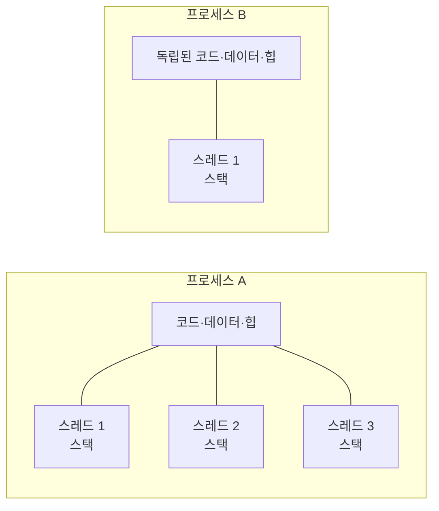

# TIL: 멀티 프로세스와 멀티 스레드

<br>

## 오늘 배운 내용

멀티 프로세스와 멀티 스레드는 프로그램의 작업을 여러 실행 단위로 나누어 처리하는 방식이다.

- **멀티 프로세스(Multi Process)**: 여러 프로세스를 실행한다.
- **멀티 스레드(Multi Thread)**: 한 프로세스 안에서 여러 스레드를 실행한다.

두 방식 모두 작업을 동시에 처리할 수 있지만, 메모리를 나누는 방법과 작업 간 통신 방식이 다르다.

<br>

## 프로세스와 스레드의 메모리 구조

프로세스는 실행 중인 프로그램이며, 각 프로세스는 운영체제로부터 독립된 메모리 공간을 할당받는다.

스레드는 프로세스 안에서 작업을 수행하는 실행 단위다. 같은 프로세스의 스레드들은 코드, 데이터, 힙 영역을 공유하지만, 각자의 스택과 실행 상태를 가진다.



<br>

## 멀티 프로세스

멀티 프로세스는 여러 프로세스를 실행해 각 프로세스가 작업을 나누어 처리하는 방식이다.

프로세스마다 메모리 공간이 분리되어 있다. 한 프로세스에서 문제가 생겨도 다른 프로세스의 메모리를 직접 덮어쓰기는 어렵다. 대신 프로세스끼리 데이터를 주고받으려면 파이프, 소켓, 공유 메모리 같은 **프로세스 간 통신(IPC, Inter-Process Communication)** 방법이 필요하다.

### 장점

- 각 프로세스의 메모리가 분리되어 있어 서로 영향을 덜 준다.
- 한 프로세스의 오류가 다른 프로세스에 바로 전파될 가능성이 낮다.
- 작업별로 실행 파일이나 권한을 분리하기 편하다.

### 단점

- 프로세스를 만들고 관리하는 데 자원이 든다.
- 프로세스끼리 데이터를 주고받으려면 IPC를 사용해야 한다.
- 데이터를 복사하거나 IPC를 처리하는 데 추가 비용이 생길 수 있다.

## 멀티 스레드

멀티 스레드는 하나의 프로세스 안에서 여러 스레드가 작업을 나누어 처리하는 방식이다.

스레드들은 같은 프로세스의 코드, 데이터, 힙을 공유한다. 그래서 공유 데이터에 빠르게 접근할 수 있지만, 여러 스레드가 동시에 같은 데이터를 수정하면 값이 예상과 다르게 바뀔 수 있다. 이를 막으려면 뮤텍스나 락 같은 **동기화 도구**를 사용해야 한다.

### 장점

- 스레드끼리 같은 메모리를 사용하므로 데이터를 주고받기 편하다.
- 프로세스보다 생성과 전환에 드는 비용이 일반적으로 적다.
- 여러 작업을 나누어 응답성을 높일 수 있다.

### 단점

- 공유 데이터를 동시에 수정하면 데이터 경쟁(Race Condition)이 발생할 수 있다.
- 락을 잘못 사용하면 교착 상태(Deadlock)가 생길 수 있다.
- 한 스레드의 잘못된 메모리 접근이 같은 프로세스의 다른 스레드에도 영향을 줄 수 있다.

<br>

## 멀티 스레드에서 공유 데이터 보호하기

아래는 여러 스레드가 하나의 공유 변수에 접근할 때 뮤텍스로 보호하는 예시다.

```cpp
#include <iostream>
#include <mutex>
#include <thread>
#include <vector>

using namespace std;

int counter = 0;       // 모든 스레드가 함께 사용하는 변수
mutex counterMutex;    // counter 접근을 보호하는 뮤텍스

void IncreaseCounter()
{
    for (int i = 0; i < 10000; i++)
    {
        lock_guard<mutex> lock(counterMutex);
        counter++;
    }
}

int main()
{
    vector<thread> threads;

    for (int i = 0; i < 4; i++)
    {
        threads.emplace_back(IncreaseCounter);
    }

    for (thread& t : threads)
    {
        t.join(); // 모든 스레드의 작업이 끝날 때까지 기다린다.
    }

    cout << counter << '\n';

    return 0;
}
```

`counter++`는 한 번에 끝나는 단순한 동작처럼 보이지만, 내부적으로는 값을 읽고 증가시킨 뒤 다시 저장하는 과정으로 이루어진다. 여러 스레드가 이 과정을 동시에 실행하면 증가 횟수가 누락될 수 있다.

`lock_guard`는 뮤텍스를 잠근 뒤 현재 범위를 벗어날 때 자동으로 잠금을 해제한다. 이 예시에서는 한 번에 하나의 스레드만 `counter++`를 실행하므로 결과가 `40000`이 된다.

<br>

## 비교

| 구분 | 멀티 프로세스 | 멀티 스레드 |
|---|---|---|
| 실행 단위 | 여러 프로세스 | 한 프로세스 안의 여러 스레드 |
| 메모리 | 프로세스마다 독립된 공간 | 코드·데이터·힙을 공유하고 스택은 각각 가짐 |
| 데이터 전달 | IPC 필요 | 공유 메모리를 통해 전달하기 쉬움 |
| 생성·관리 비용 | 일반적으로 더 큼 | 일반적으로 더 작음 |
| 주요 주의점 | IPC와 프로세스 관리 | 동기화, 데이터 경쟁, 교착 상태 |
| 오류 영향 | 프로세스 간 격리가 비교적 쉬움 | 같은 프로세스의 다른 스레드에 영향을 줄 수 있음 |

<br>

## 동시성과 병렬성

여러 작업이 동시에 진행되는 것처럼 보인다고 해서 항상 실제로 같은 순간에 실행되는 것은 아니다.

- **동시성(Concurrency)**: 여러 작업이 번갈아 실행되며 진행되는 것
- **병렬성(Parallelism)**: 여러 작업이 서로 다른 CPU 코어에서 실제로 같은 순간에 실행되는 것

CPU 코어가 하나여도 운영체제가 실행 작업을 빠르게 바꾸면 여러 작업이 동시에 진행되는 것처럼 보일 수 있다. CPU 코어가 여러 개라면 여러 작업을 실제로 병렬 실행할 수 있다.

<br>

## 게임 클라이언트에서의 활용

게임은 프레임마다 많은 작업을 처리하므로 여러 스레드로 작업을 나눌 수 있다.

예를 들면 다음과 같은 작업이 있다.

- 게임 로직 처리
- 렌더링 준비
- 파일이나 에셋 로딩
- 물리 계산
- 백그라운드 작업

언리얼 엔진도 게임 스레드와 렌더 스레드 등 여러 실행 흐름을 사용한다. 다만 엔진 객체와 데이터는 접근 가능한 스레드가 정해져 있을 수 있으므로, 작업을 다른 스레드로 옮길 때는 스레드 안전성과 엔진 규칙을 확인해야 한다.

<br>

## 헷갈렸던 점과 해결

### 스레드는 메모리를 전부 공유할까?

아니다. 같은 프로세스의 스레드는 코드, 데이터, 힙을 공유하지만 각자의 스택을 가진다. 함수의 지역 변수처럼 스택에 저장되는 값은 각 스레드의 실행 흐름에 속한다.

### 멀티 스레드가 항상 더 빠를까?

아니다. 작업을 나누고 스레드를 관리하는 데 비용이 들 수 있다. 작업량이 적거나 동기화가 잦으면 오히려 느려질 수 있다. 여러 스레드로 나누었을 때의 이점이 관리 비용보다 클 때 성능 향상을 기대할 수 있다.

### 멀티 프로세스는 오류가 완전히 격리될까?

완전히 격리되는 것은 아니다. 메모리 공간이 분리되어 직접적인 간섭이 줄어들지만, 운영체제 자원이나 IPC, 공유 자원에서 문제가 생길 수 있다. 따라서 “상대적으로 격리하기 쉽다”고 이해하는 것이 정확하다.

<br>

## 오늘 배운 내용 정리

- 멀티 프로세스는 여러 프로세스를 실행하며, 각 프로세스는 독립된 메모리 공간을 가진다.
- 멀티 스레드는 한 프로세스에서 여러 스레드를 실행하며, 코드·데이터·힙을 공유한다.
- 프로세스 간 통신에는 IPC가 필요하고, 스레드 간 공유 데이터에는 동기화가 필요할 수 있다.
- 멀티 스레드는 항상 더 빠른 것이 아니며, 작업 특성과 동기화 비용을 함께 고려해야 한다.
- 동시성은 여러 작업이 번갈아 진행되는 것이고, 병렬성은 여러 작업이 실제로 같은 순간에 실행되는 것이다.

## 참고 자료

- cppreference.com, [`std::thread`](https://en.cppreference.com/w/cpp/thread/thread)
- cppreference.com, [`std::mutex`](https://en.cppreference.com/w/cpp/thread/mutex)
- Microsoft Learn, [Processes and Threads](https://learn.microsoft.com/en-us/windows/win32/procthread/processes-and-threads)
