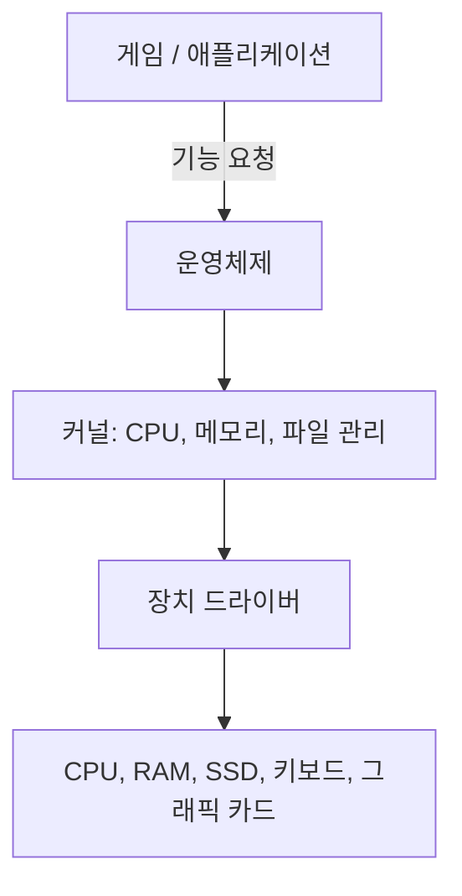
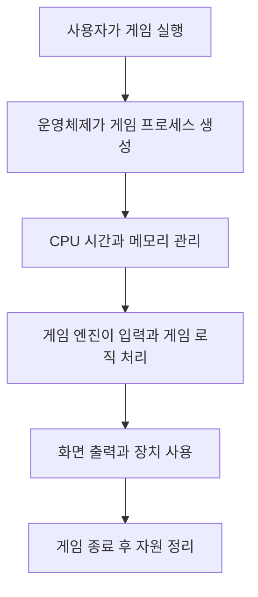

# TIL: 운영체제란 무엇일까?

 

## 오늘 배운 내용

운영체제(Operating System, OS)는 컴퓨터의 하드웨어와 프로그램 사이에서 자원을 관리하고, 프로그램이 컴퓨터를 사용할 수 있도록 도와주는 기본 소프트웨어다.

게임이나 브라우저 같은 프로그램은 CPU, 메모리, 저장장치, 키보드, 그래픽 카드 같은 하드웨어를 직접 하나씩 제어하지 않는다. 운영체제에 필요한 작업을 요청하고, 운영체제는 여러 프로그램이 하드웨어를 함께 사용할 수 있도록 조정한다.

예를 들어 게임을 실행하면 운영체제는 게임을 실행 중인 프로그램으로 등록하고, 메모리를 사용할 수 있도록 준비하며, CPU가 게임의 작업을 처리할 시간을 배정한다.

운영체제가 없다면 각 프로그램이 하드웨어를 직접 관리해야 한다. 여러 프로그램이 동시에 실행될 때 서로 같은 장치나 메모리를 사용하려고 충돌할 수 있고, 프로그램마다 키보드나 저장장치를 다루는 방식도 달라질 수 있다. 운영체제는 이런 복잡한 처리를 맡아 프로그램이 비교적 일정한 방식으로 컴퓨터를 사용할 수 있게 한다.

---

 

## 운영체제가 하는 일

    
### 1. 프로그램 실행 관리

운영체제는 프로그램을 실행하고 종료하는 과정을 관리한다.

실행 파일을 시작하면 운영체제는 실행에 필요한 환경을 준비하고, 프로그램이 실행 중인 단위인 **프로세스(Process)** 를 만든다. 프로세스에는 실행 상태와 메모리 공간, 운영체제가 관리하는 여러 정보가 연결된다.

프로그램이 종료되면 운영체제는 해당 프로세스가 사용하던 자원을 정리한다.

 

### 2. CPU 사용 시간 관리

컴퓨터에서는 여러 프로그램이 동시에 실행되는 것처럼 보인다. 실제로 CPU가 처리할 수 있는 작업에는 한계가 있기 때문에, 운영체제는 실행할 작업에 CPU 사용 시간을 배정한다.

운영체제는 어떤 작업을 먼저 처리할지 결정하고, 실행 중인 작업을 잠시 멈춘 뒤 다른 작업을 실행하기도 한다. 이러한 관리를 **스케줄링(Scheduling)**이라고 한다.

게임은 플레이어 입력 처리, 캐릭터 이동, AI 계산, 사운드 처리 등 다양한 작업을 수행한다. 운영체제는 게임을 실행하는 스레드들이 CPU를 사용할 수 있도록 관리한다.

 

### 3. 메모리 관리

운영체제는 프로그램이 메모리를 사용할 수 있도록 관리하고, 서로 다른 프로그램의 메모리가 함부로 섞이지 않도록 보호한다.

각 프로세스는 자신만의 메모리 공간을 사용하는 것처럼 동작한다. 이 공간을 **가상 메모리 공간**이라고 한다. 실제 메모리 위치와 가상 주소의 연결은 운영체제와 하드웨어가 함께 관리한다.

가상 메모리 덕분에 프로그램은 다른 프로그램의 메모리를 직접 다루지 않고도 실행될 수 있다. 또한 운영체제는 프로그램이 사용할 수 있는 메모리와 접근 권한을 관리한다.

게임에서 캐릭터의 체력, 현재 위치, 장착한 무기 같은 정보도 실행 중 메모리에 놓인다. 게임을 종료하면 실행 중에 사용한 메모리는 운영체제가 정리한다. 게임을 다시 실행한 뒤에도 유지해야 하는 값은 세이브 파일 등에 따로 기록해야 한다.

 

### 4. 파일과 저장장치 관리

운영체제는 파일과 폴더를 만들고, 읽고, 수정하고, 삭제하는 기능을 제공한다.

프로그램은 저장장치의 물리적인 위치를 직접 찾아 데이터를 읽기보다 파일 이름과 경로를 사용해 필요한 작업을 요청한다. 운영체제는 파일 시스템을 통해 파일의 위치와 저장 상태를 관리한다.

예를 들어 게임이 설정 파일이나 세이브 파일을 읽고 저장할 때도 운영체제가 제공하는 파일 기능을 이용한다.

 

### 5. 키보드, 마우스, 그래픽 카드 등 장치 관리

운영체제는 키보드, 마우스, 모니터, 그래픽 카드, 네트워크 장치 같은 하드웨어를 관리한다.

하드웨어마다 동작 방식이 다르기 때문에 운영체제는 **장치 드라이버(Device Driver)** 등을 통해 장치와 통신한다. 프로그램은 장치의 세부 동작을 모두 직접 구현하는 대신 운영체제에서 제공하는 기능을 이용할 수 있다.

게임에서 키보드 입력을 받거나 화면을 출력하는 과정에도 운영체제의 장치 관리와 그래픽 드라이버가 관여한다.

---

 

## 커널과 운영체제의 관계

**커널(Kernel)**은 운영체제의 핵심 부분이다. CPU, 메모리, 프로세스, 장치와 같이 중요한 자원을 관리한다.

운영체제라는 말은 커널만 가리키기도 하지만, 보통은 커널과 함께 프로그램 실행 환경, 시스템 도구, 사용자 인터페이스 등 컴퓨터를 사용할 수 있게 하는 여러 구성 요소를 포함하는 넓은 의미로 사용한다.

운영체제의 핵심 기능은 커널이 담당하고, 사용자가 실행하는 일반 프로그램은 보통 커널의 기능을 직접 조작하지 않고 운영체제가 제공하는 인터페이스를 통해 요청한다.

---

 

## 프로그램은 운영체제에 어떻게 요청할까?

일반 프로그램이 파일을 읽거나 메모리를 요청하는 것처럼 운영체제의 보호가 필요한 작업을 하려면 운영체제에 요청해야 한다. 이런 요청을 위한 통로 중 하나가 **시스템 호출(System Call)**이다.

예를 들어 프로그램이 파일을 열고 싶을 때는 운영체제에 파일 열기를 요청한다. 운영체제는 요청이 허용되는지 확인하고, 필요한 작업을 수행한 다음 결과를 프로그램에 돌려준다.

운영체제는 중요한 자원을 보호하기 위해 프로그램이 실행되는 권한과 운영체제 핵심 기능의 권한을 구분한다. 일반 프로그램이 제한된 권한으로 실행되다가 파일 접근이나 장치 제어처럼 더 높은 권한이 필요한 작업을 요청하면, 운영체제가 정해진 절차에 따라 처리한다.

---

 

## 게임 개발과 연결하기

게임을 실행하고 플레이하는 동안 운영체제와 게임 엔진은 서로 다른 역할을 맡는다.

1. 사용자가 게임 실행 파일을 실행한다.
2. 운영체제가 게임 프로세스를 만들고 실행 환경을 준비한다.
3. 운영체제가 게임의 실행 스레드에 CPU를 사용할 기회를 배정한다.
4. 게임 엔진은 입력, 캐릭터 이동, AI, 애니메이션 등 게임 로직을 처리한다.
5. 게임 엔진은 운영체제와 그래픽 드라이버가 제공하는 기능을 통해 화면 출력 등을 요청한다.
6. 게임을 종료하면 운영체제가 프로세스가 사용하던 자원을 정리한다.

플레이어가 키보드에서 점프 키를 눌렀을 때 운영체제가 게임의 점프 규칙을 결정하는 것은 아니다. 운영체제와 입력 장치 관련 구성 요소가 입력을 프로그램에 전달할 수 있도록 돕고, 실제로 캐릭터가 점프할지는 게임의 입력 처리와 게임 로직이 결정한다.

마찬가지로 운영체제는 게임의 AI 행동이나 무기 데미지를 결정하지 않는다. 그런 규칙은 게임 코드와 엔진이 담당하고, 운영체제는 게임이 실행될 수 있도록 CPU, 메모리, 파일, 장치 같은 컴퓨터 자원을 관리한다.

---

 

## 자주 헷갈리는 점

 

### 운영체제와 게임은 같은 프로그램이 아니다

운영체제는 컴퓨터의 자원과 프로그램 실행 환경을 관리한다. 게임은 운영체제 위에서 실행되며 게임 규칙과 화면, 입력 처리를 구현한다.

 

### 프로세스와 프로그램은 다르다

프로그램은 실행 파일이나 프로그램 코드처럼 실행할 수 있는 내용을 말한다. 프로세스는 그 프로그램이 실행되면서 운영체제가 관리하는 실행 단위다.

 

### 운영체제가 게임의 모든 일을 처리하지는 않는다

운영체제는 게임이 사용할 컴퓨터 자원을 관리한다. 캐릭터의 이동, 무기의 발사, 적 AI의 행동처럼 게임 규칙에 해당하는 일은 게임과 게임 엔진이 처리한다.

 

### 가상 메모리가 있다고 해서 메모리가 무한한 것은 아니다

각 프로세스가 자신만의 메모리 공간을 사용하는 것처럼 보이지만, 실제 시스템에는 사용할 수 있는 메모리의 한계가 있다. 프로그램이 지나치게 많은 메모리를 사용하면 성능이 떨어지거나 실행에 실패할 수 있다.

---

 

## 참고한 자료

- [About Processes and Threads - Microsoft Learn](https://learn.microsoft.com/en-us/windows/desktop/ProcThread/about-processes-and-threads)  
  프로세스와 스레드의 관계, 프로세스가 가진 가상 메모리 공간을 확인했다.

- [About Memory Management - Microsoft Learn](https://learn.microsoft.com/en-us/windows/win32/memory/about-memory-management)  
  프로세스별 가상 주소 공간과 메모리 관리 개념을 참고했다.

- [Local File Systems - Microsoft Learn](https://learn.microsoft.com/en-us/windows/win32/FileIO/file-systems)  
  운영체제에서 파일 시스템과 파일을 관리하는 방식을 참고했다.

 

## 오늘의 정리

운영체제는 프로그램과 하드웨어 사이에서 컴퓨터 자원을 관리한다. 프로그램 실행, CPU 사용 시간 배정, 메모리 보호, 파일 관리, 장치 제어 등을 담당한다.

게임을 실행하면 운영체제가 게임 프로세스와 실행 환경을 준비하고, 게임 엔진은 그 환경에서 게임 규칙과 로직을 처리한다. 따라서 운영체제는 게임의 캐릭터나 AI를 직접 움직이는 것이 아니라, 게임이 컴퓨터의 자원을 사용할 수 있도록 관리하는 역할을 한다.
