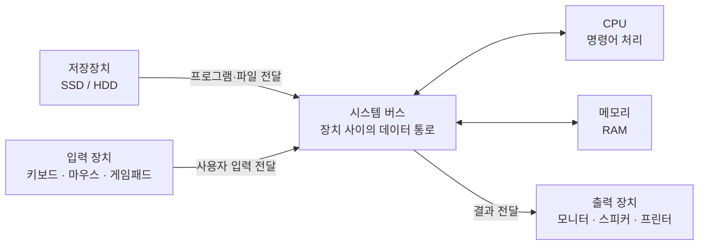

# TIL: 컴퓨터 시스템의 구조

  

## 오늘 배운 내용

컴퓨터 시스템은 CPU, 메모리(RAM), 저장장치(SSD/HDD), 입출력 장치(I/O)처럼 여러 부분이 함께 동작한다. 각 장치는 시스템 버스를 통해 데이터를 주고받으며 프로그램을 실행한다.

 

## 컴퓨터 시스템 구조 한눈에 보기

 

## 컴퓨터 시스템을 구성하는 장치

### 1. CPU

CPU(Central Processing Unit)는 프로그램의 명령어를 처리하는 장치다. 명령어를 읽고(Fetch), 해석하고(Decode), 실행(Execute)하는 과정을 반복한다.

쉽게 말해, 프로그램이 어떤 작업을 해야 하는지 처리하고 실행하는 부분이다.

### 2. 메모리(RAM)

RAM은 프로그램이 실행되는 동안 필요한 데이터와 명령어를 잠시 보관하는 작업 공간이다. CPU는 작업에 필요한 정보를 RAM에서 가져와 처리한다.

RAM은 임시 저장 공간이므로 컴퓨터 전원이 꺼지면 그 안의 내용이 사라진다.

### 3. 저장장치(SSD/HDD)

SSD와 HDD는 프로그램과 파일을 저장하는 장치다. 컴퓨터 전원을 꺼도 저장된 데이터가 유지된다.

게임을 예로 들면 게임 설치 파일, 텍스처, 모델링, 사운드 파일 등이 저장장치에 보관된다. 게임을 실행하면 필요한 데이터가 저장장치에서 RAM으로 전달된다. 저장장치는 데이터를 오래 보관하고, RAM은 실행 중인 프로그램이 사용할 데이터를 임시로 담는다.

### 4. 입출력 장치(I/O)

입출력 장치는 사용자와 컴퓨터가 데이터를 주고받도록 한다.

**입력 장치**는 사용자의 명령을 컴퓨터에 전달한다.

- 키보드
- 마우스
- 게임패드

**출력 장치**는 컴퓨터가 처리한 결과를 사용자에게 보여주거나 들려준다.

- 모니터
- 스피커
- 프린터

 

## 게임 실행 과정으로 이해하기

1. 게임 파일과 에셋은 SSD나 HDD에 저장되어 있다.
2. 게임을 실행하면 필요한 프로그램과 데이터가 RAM으로 전달된다.
3. CPU는 RAM에 있는 명령어와 데이터를 처리한다.
4. 키보드나 게임패드의 입력은 컴퓨터로 전달된다.
5. 처리된 결과는 모니터나 스피커 같은 출력 장치로 전달된다.

시스템 버스는 이 과정에서 각 장치가 데이터를 주고받을 수 있도록 연결하는 통로 역할을 한다.

 

## 헷갈린 점과 해결 과정

- **RAM과 SSD/HDD는 무엇이 다를까?**  
  RAM은 프로그램 실행 중에 데이터를 잠시 보관하는 공간이고, SSD/HDD는 파일을 전원이 꺼져도 유지되도록 저장하는 공간이다.

- **게임 파일은 어디에 있을까?**  
  설치된 게임 파일은 SSD/HDD에 저장된다. 게임을 실행하면 필요한 데이터가 RAM으로 옮겨져 작업에 사용된다.

- **입력 장치와 출력 장치는 어떻게 구분할까?**  
  키보드나 마우스처럼 사용자의 명령을 전달하는 장치는 입력 장치다. 모니터나 스피커처럼 처리 결과를 보여주는 장치는 출력 장치다.

 

## 학습 기록

이번에는 컴퓨터 시스템을 구성하는 장치의 역할과 데이터가 이동하는 흐름을 정리했다. 별도의 코드나 명령어를 실행하는 실습은 하지 않았다.

  

## 오늘 배운 내용 정리

컴퓨터 시스템은 CPU, RAM, SSD/HDD, 입출력 장치가 함께 동작하는 구조다. 프로그램과 파일은 저장장치에 보관되고, 실행에 필요한 데이터는 RAM으로 전달된다. CPU는 RAM의 명령어와 데이터를 처리하며, 시스템 버스를 통해 다른 장치와 정보를 주고받는다. 사용자의 입력은 입력 장치로 전달되고, 처리 결과는 출력 장치를 통해 확인할 수 있다.
